# Building Your Zotero Library
{: .no_toc }

  

    Table of contents
  

  {: .text-delta }
1. TOC
{:toc}

This section describes the various ways to add items (including books,
journal articles, web pages, etc.) as items in Zotero.

# Using Zotero Connector via your web browser

For this you need to [install the Zotero
Connector](https://www.zotero.org/download) for Chrome, Firefox, Edge,
or Safari, in addition to the Zotero desktop app.

The Zotero Connector’s save button is the most convenient and reliable
way to add items with high-quality bibliographic metadata to your Zotero
library. As you browse the web, the Zotero Connector will automatically
find bibliographic information on webpages you visit and allow you to
add it to Zotero with a single click.

For example, if you’re on the main page for a journal article, the save
button will change to the icon of a journal article
(circled in red):

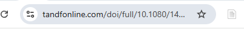

On a library catalog entry for a book, the save button will show a book
icon:

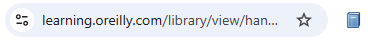

Clicking the save button will create an item in Zotero with the
information it has identified.

On many sites, Zotero will also save any PDF accessible from the page or
an open-access PDF that can be found for the saved item.

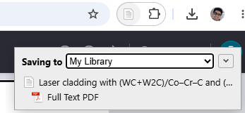

## Generic Webpages

If you click the save button on webpages, Zotero will import the page as
a “Web Page” item with a title, URL, access date and snapshot. Zotero
can archive a webpage by creating a snapshot — an offline file
reflecting the state of the page at the time the snapshot was taken.

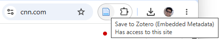

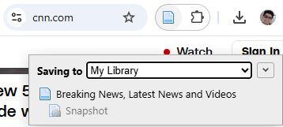

If the Zotero Connector does not recognize data on a page, you can save
the page as a Web Page item with an attached snapshot by clicking the
Zotero save button in the browser toolbar. You can also take a snapshot
of any page by right-clicking (click-and-hold in Safari) on the Zotero
save button and choosing “Save to Zotero (Web Page with Snapshot)”.

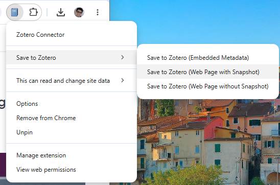

By default, Zotero will save snapshots when importing items from
webpages. You can disable this setting in the [<u>Zotero
preferences</u>](https://www.zotero.org/support/preferences/general).

Such snapshots and PDFs are stored as copies in [<u>Zotero data
directory</u>](https://www.zotero.org/support/zotero_data), and appear
as child items of the saved item.

## PDFs

If you are viewing a PDF file in your browser, the save button will show
a PDF icon. Clicking this button will import the PDF file alone into
your library and then automatically attempt to [<u>retrieve
metadata</u>](https://www.zotero.org/support/retrieve_pdf_metadata)
about it. While this will often produce good results, it is usually
better to use the save button from the publication’s abstract page or
catalog entry, as described above, if there is one.

If you save a PDF directly and Zotero isn’t able to retrieve metadata,
it will leave the PDF as a standalone attachment. To add metadata,
you’ll need to create a parent item, either by saving a regular
bibliographic item and dragging the PDF on top of it or by
right-clicking on the PDF, choosing Create Parent Item, and entering an
identifier such as a DOI or ISBN. If all else fails, you can click
Manual Entry after selecting Create Parent Item and manually enter
metadata for the item.

## Multiple Web Search Results

On some webpages that contain information about multiple items (e.g., a
list of Google Scholar search results), the save button will show a
folder icon. Clicking this folder icon will open a window where you can
select the items that you want to save to Zotero:

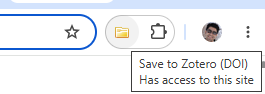

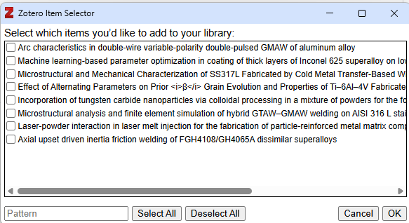

## Saving to a Specific Collection or Library

After you click the save button, a popup will appear indicating which
Zotero collection the item is being saved to. If you want to save the
item to a different collection or library, you can change the selection
there, as well as enter tags to assign to the new item.

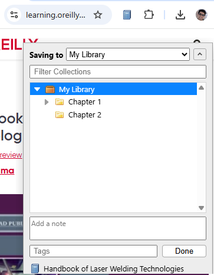

## Data Quality and Choosing a Translator

The quality of the data Zotero imports is determined by the information
supplied on the webpage. Some websites include high-quality data for
tools like Zotero in the page itself (“embedded metadata”). Other
websites provide only limited metadata (e.g., only the title of a blog
post) or no metadata at all. For many sites, Zotero has website-specific
“translators” to obtain the best quality metadata. Zotero recognizes
almost all library catalogs, most news sites, research databases, and
scientific publishers. (For more information, see Zotero’s
[<u>compatible websites
list</u>](https://www.zotero.org/support/translators).) Metadata for the
same item may vary in quality across sites providing it. For example,
importing an item from the publisher’s website will generally yield much
better data than importing from Google Scholar.

Zotero will generally choose the best translator available for each site
automatically. You can choose an alternative translator by
right-clicking on the Zotero save button (or the page background in
Safari) and choosing one of the available options.

# Add Item by Identifier

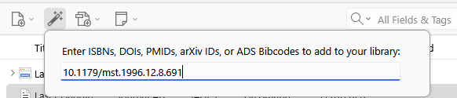

You can quickly add items to your library if you already know their
ISBN, DOI, PubMed ID, arXiv ID, or ADS Bibcode. Click the Add Item by
Identifier button
() in the toolbar, type or
paste in the identifier, and press Enter/Return on your keyboard. To add
more than one item, separate identifiers by spaces, commas, or line
breaks.

To look up metadata, Zotero uses Library of Congress,
[<u>WorldCat</u>](http://www.worldcat.org/), and other catalogs for
ISBNs, [<u>CrossRef</u>](http://www.crossref.org/) and other registries
for DOIs, [<u>NCBI PubMed</u>](http://www.ncbi.nlm.nih.gov/pubmed/) for
PubMed IDs, [<u>arXiv.org</u>](https://arxiv.org/) for arXiv IDs, and
[<u>ADS</u>](https://ui.adsabs.harvard.edu/) for ADS Bibcodes.

# Drag and Drop[\#](https://www.zotero.org/support/attaching_files#drag_and_drop)

Files can be copied into your library by dragging a file from your
operating system’s file browser into the Zotero window, and either
dropping it onto a collection in the left pane, or onto the center pane.
Files dropped onto an existing regular Zotero item in the center pane
are added as child items. Files dropped onto a collection, or in an
empty space or between items in the center pane, are added as standalone
items.

By default, files dragged into Zotero are added as **copies** of the
original files. To instead add **links** to the original files, hold
down Ctrl+Shift (Windows/Linux) or Cmd+Option (Mac) while dropping. (On
macOS, it may be necessary to allow the Zotero window to come to the
front before letting go for the modifier key to take effect.)

You can also drag and drop an existing standalone file item in Zotero
onto a regular Zotero item to create a child item.

## Stored Files

Files can be added to your Zotero library as either stored files or
linked files.

Stored files, which are the default, are stored within the [<u>Zotero
data directory</u>](https://www.zotero.org/support/zotero_data), and
Zotero will automatically manage them, including deleting them if you
delete the attachment item in Zotero. If you use [<u>file
syncing</u>](https://www.zotero.org/support/sync), Zotero will
automatically sync stored files between devices and make them available
in your online library on zotero.org. If you add a stored file from a
file on your computer, the file is copied to the Zotero data directory,
so you may wish to delete the original to avoid confusion.

To use stored files outside of Zotero, you can use Zotero’s search and
organization abilities to quickly find the relevant items and then
either drag the attachments straight from Zotero (e.g., into an email)
or right-click and choose Show File to view the files in your file
manager. If you prefer to find files without going through Zotero, you
can use your operating system’s search features (e.g., Spotlight on
macOS) or create a smart folder in your OS to show a list of all PDFs
within your Zotero data directory and interact with the files directly.
Zotero automatically renames files based on the parent item’s
bibliographic data, so you can easily find files by title, author, or
year even from outside Zotero.

## Linked Files

With linked files, Zotero only stores a link to the location of the
original file on your computer. Linked files are not synced, nor are
they deleted if the attachment item is deleted in Zotero. They also
can’t be used within a group library, as there’s no guarantee that other
group m embers would have access to the same file location. Linked files
are also not supported in the [<u>Zotero iOS
app</u>](https://apps.apple.com/us/app/zotero/id1513554812) or the
[<u>Android
app</u>](https://play.google.com/store/apps/details?id=org.zotero.android).

You can add a linked file by selecting an existing item and choosing
“Attach Link to File…” from the Add Attachment menu in the Zotero
toolbar or, to use [<u>PDF metadata
retrieval</u>](https://www.zotero.org/support/retrieve_pdf_metadata), by
selecting “Link to File…” from the New Item menu. You
can also use the appropriate OS-specific modifier key for linking files
while dragging in a file from the filesystem.

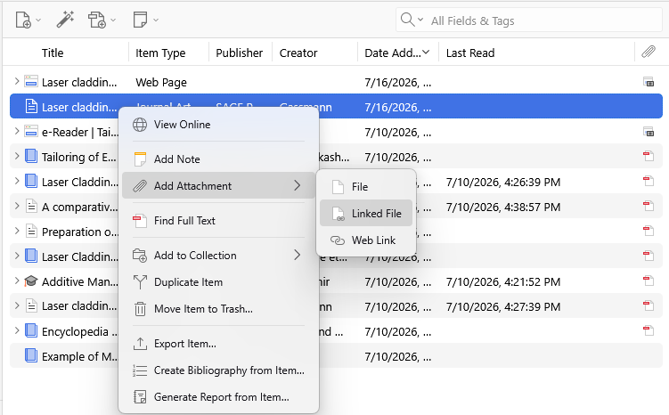

If you sync linked files using an external tool (Google Drive, etc.) for
use on multiple computers, it is a good idea to set the [<u>linked
attachment base
directory</u>](https://www.zotero.org/support/preferences/advanced#linked_attachment_base_directory)
so that the files can be found by Zotero on each computer even if the
containing folder is at a different location in the filesystem.

If you wish to convert linked files to stored files in order to allow
Zotero to manage them, you can do so from the Tools → Manage Attachments
menu.

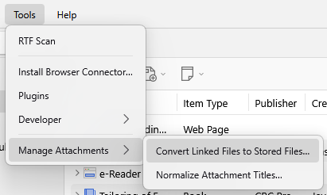

## Child versus Standalone Attachment Files

Files can be added either as *standalone items* or as *child items* to
regular Zotero bibliographic metadata items. It is generally always a
good idea to work with files as child items. Standalone files cannot be
used with many of Zotero’s features, including citing, My Publications,
and most types of searching, because they lack bibliographic metadata.

If you save a PDF directly to your library, Zotero will attempt to
[<u>retrieve
metadata</u>](https://www.zotero.org/support/retrieve_pdf_metadata) for
it and create a parent item automatically. If the item can’t be
recognized, you’ll be left with a standalone attachment. You can add a
parent by either [<u>saving an item from the
web</u>](https://www.zotero.org/support/adding_items_to_zotero) and
dragging the PDF on top of it (if a PDF isn’t attached automatically) or
by right-clicking on the PDF, choosing Create Parent Item, and entering
an identifier such as a DOI or ISBN. If all else fails, you can click
Manual Entry after selecting Create Parent Item and manually enter
metadata for the item.

### Attachment Menu[\#](https://www.zotero.org/support/attaching_files#attachment_menu)

When you have selected a single item in the center pane, you can click
the “Add Attachment” button at the top of the center column. Select
either “Attached Stored Copy of File…” or “Attach Link to File…” to add
files as attachments to the item.

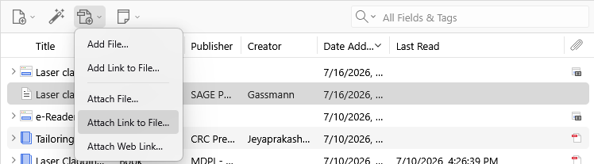

You can also “Attach Link to URI…” to add a link to a web page
(<http://> or <https://>) or to another program on your computer (e.g.,
OneNote <onenote://> or Evernote evernote://).

These options are also available when you right-click an item and choose
“Add Attachment”.

# Manually Adding Items[\#](https://www.zotero.org/support/adding_items_to_zotero#manually_adding_items)

Zotero is designed to help you avoid manual entry whenever possible,
however if you really need to add something manually — for example, a
source that isn’t available anywhere online — you can do so by clicking
“New Item”
(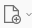) button at the top of the
middle pane and selecting the desired item type from the drop-down menu.
An empty item of the selected item type will now appear in the center
column. You can then manually enter the item’s bibliographic information
via the right-hand pane.

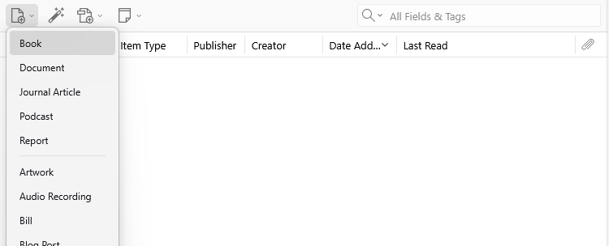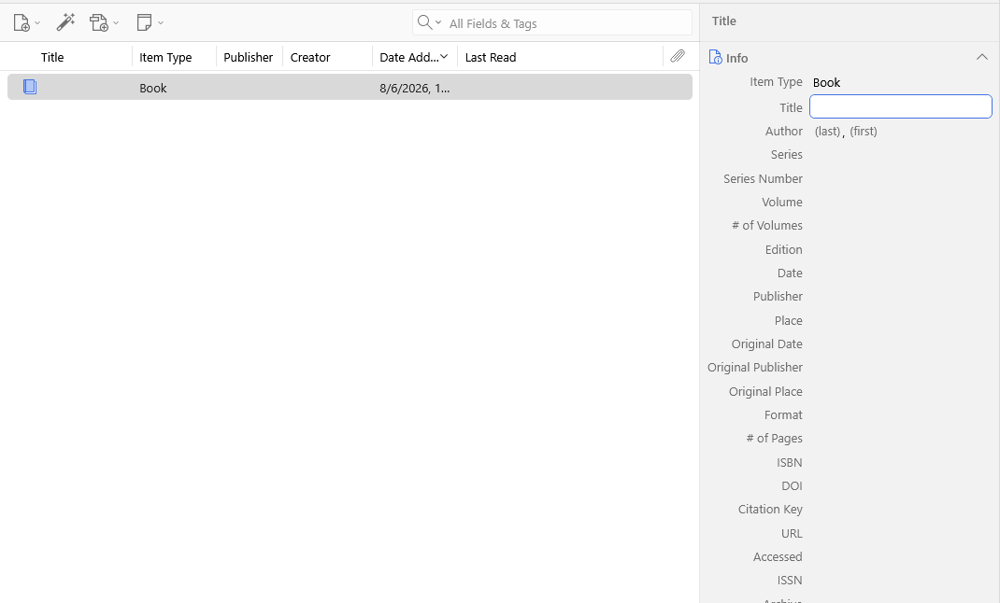

**Note:** Since it’s almost always better to visit a webpage in your
browser and use the “Save to Zotero” button, the Web Page item type is
not included in the “New Item” menu. However, if you really want to
create a webpage item by hand, you create an empty item of another type
and switch the item type to Web Page in the right-hand pane.

# Accessing Files[\#](https://www.zotero.org/support/attaching_files#accessing_files)

Files in your library can be accessed by double-clicking the item in the
center pane. Alternatively, you can right-click the item and select
“View PDF” or “View File”.

To locate a stored (copied) or linked file, right-click the item in the
Zotero pane and select “Show File”. Copied files are stored in the
[<u>Zotero data
directory</u>](https://www.zotero.org/support/zotero_data), and each
file has its own subdirectory, which is named with a random 8-character
string.

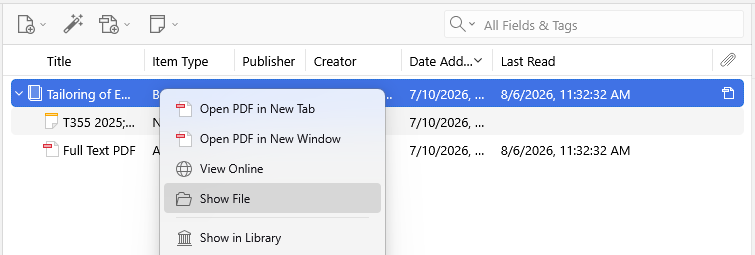

# Feeds

Feeds are a great way to discover new research. With feeds, you can
subscribe to updates from a journal, website, publisher, institution,
research group, or other source and quickly find new articles or works.
If you find an item in a publication’s feed that you want to save and
read further, you can add it to your Zotero library with the click of a
button.

## Subscribing to Feeds[\#](https://www.zotero.org/support/feeds#subscribing_to_feeds)

To subscribe to a feed, click File --\> New Feed in the Zotero Menu bar.
You can add feeds in two ways. First, you can add a feed using the URL
provided on the journal’s (or other source’s) website. For journals,
these are usually available from the journal homepage. Look for the RSS
icon () or search for the journal
name and “RSS feed” in a search engine. Many publishers place the RSS
icon next to social media buttons or email alert links.

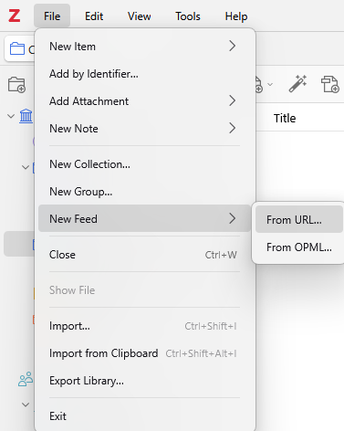

Once you’ve found the RSS feed URL for your source, click the Add Feed
menu, then choose “From URL…”. The Add Feed window will open. Paste the
RSS feed URL to the URL text field. If the URL is for a valid feed, you
will be able to enter a title for the feed and click “Save”. You can
click “Advanced Options” to adjust how frequently a feed updates and to
set how long read and unread items are kept in a feed before being
removed.

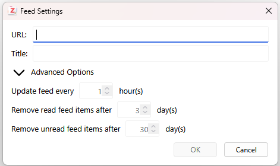

You can also import a set of feeds using an OPML file (e.g., from a list
of subscriptions exported from Feedly or other RSS Reader services). To
import an OPML file, choose “From OPML…” from the Add Feed menu.

## Reading Feeds[\#](https://www.zotero.org/support/feeds#reading_feeds)

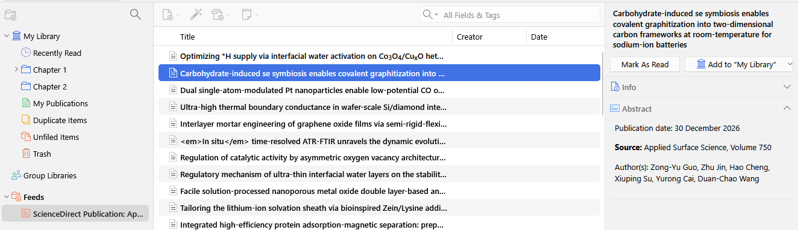

Feeds you have subscribed to will appear at the bottom of the left pane
of the Zotero window, below My Library and your Group Libraries and
above the tag selector. Click on a feed to view currently available
items in the feed. Right-click on a feed to manually refresh it, mark
all items in the feed as read, modify feed settings, or unsubscribe from
the feed.

When viewing a feed, unread items will be shown in bold text, while read
items are shown in regular text. When you select an item in the feed,
you can mark it as read or unread by clicking the “Mark As Unread/Read”
button or pressing the \` key. Save the item to your Zotero library by
clicking on the “Save to My Library” button or pressing
Ctrl/Cmd-Shift-S. You can save a feed item to a group library by
clicking the dropdown arrow on the right side of the “Save to My
Library” button and choosing the group library.

*Note, the read/unread state of items is not synced across computers
when using Zotero sync.*
