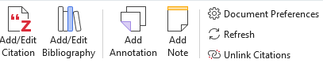
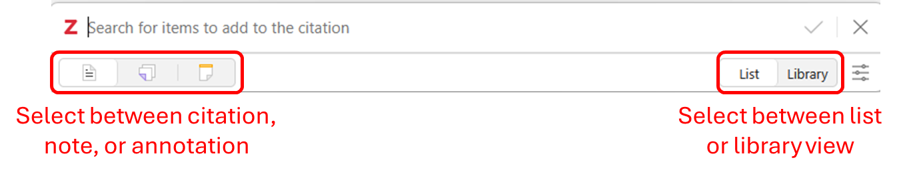
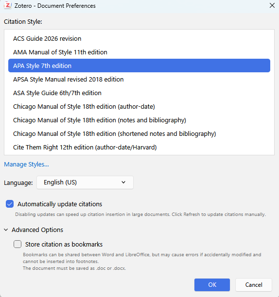
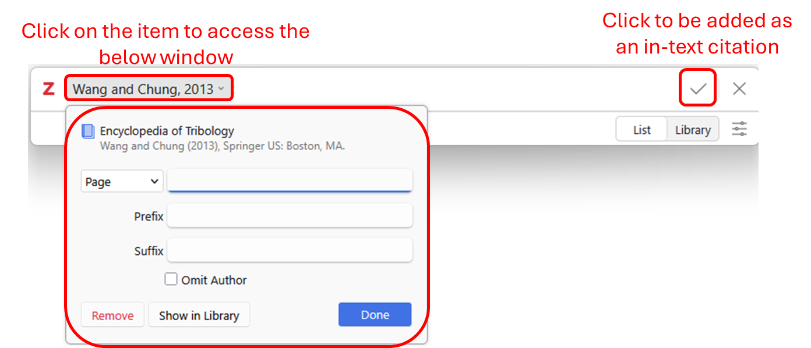
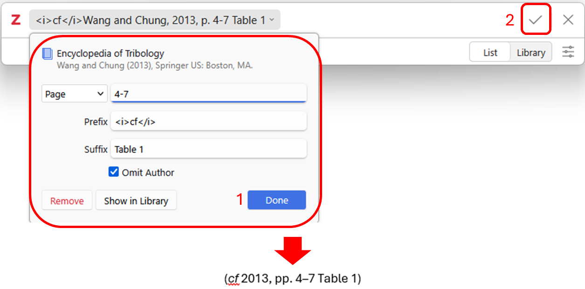
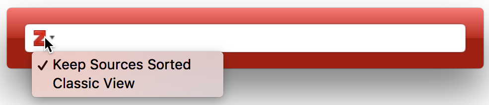
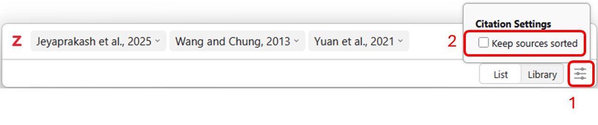
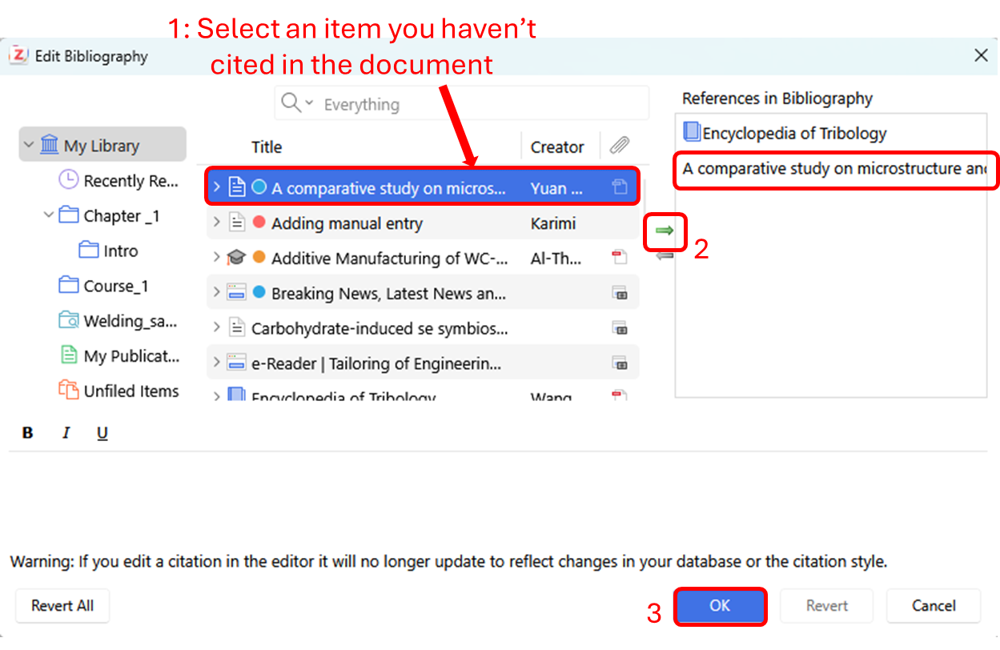

# How to do in-text citation and add an automatic reference list
{: .no_toc }

  

    Table of contents
  

  {: .text-delta }
1. TOC
{:toc}

# Word Processor Integration[\#](https://www.zotero.org/support/creating_bibliographies#word_processor_integration)

Of the different ways to automatically [<u>generate
bibliographies</u>](https://www.zotero.org/support/creating_bibliographies)
(as well as in-text citations and footnotes), the easy-to-use word
processor plugins are the most powerful. These plugins, which are
available for [Microsoft
Word](https://www.zotero.org/support/word_processor_plugin_usage),
[Google Docs](https://www.zotero.org/support/google_docs), and
[LibreOffice](https://www.zotero.org/support/libreoffice_writer_plugin_usage),
create dynamic bibliographies: insert a new in-text citation in your
manuscript, and the bibliography will be automatically updated to
include the cited item. Correct the title of an item in your Zotero
library and with a click of a button the change will be incorporated in
your documents.

In the following, we will only cover Microsoft Word, but the basics
apply if you are using other word processors. [<u>Third-party
plugins</u>](https://www.zotero.org/support/plugins#word_processor_and_writing_integration)
are also available for integrating Zotero with other word processors and
writing systems.

# Zotero Plugin Tab[\#](https://www.zotero.org/support/word_processor_plugin_usage#zotero_plugin_tab)

[<u>Installing</u>](https://www.zotero.org/support/word_processor_plugin_installation)
the Zotero Word plugin adds a Zotero tab to Microsoft Word. The Zotero
tab contains these icons:

<table style="width:85%;">
<colgroup>
<col style="width: 20%" />
<col style="width: 64%" />
</colgroup>
<thead>
<tr>
<th style="text-align: left;">Add/Edit Citation</th>
<th style="text-align: left;">Add a new citation or edit an existing
citation in your document at the cursor location.</th>
</tr>
</thead>
<tbody>
<tr>
<td style="text-align: left;">Add/Edit Bibliography</td>
<td style="text-align: left;">Insert a bibliography at the cursor
location or edit an existing bibliography.</td>
</tr>
<tr>
<td style="text-align: left;">Add Annotation</td>
<td style="text-align: left;">Add the selected annotation along with its
citation (if any) at the cursor location.</td>
</tr>
<tr>
<td style="text-align: left;">Add Note</td>
<td style="text-align: left;">Add the selected note at the cursor
location.</td>
</tr>
<tr>
<td style="text-align: left;">Document Preferences</td>
<td style="text-align: left;">Open the Document Preferences window, e.g.
to change the citation style.</td>
</tr>
<tr>
<td style="text-align: left;">Refresh</td>
<td style="text-align: left;">Refresh all citations and the
bibliography, updating any item metadata that has changed in your Zotero
library.</td>
</tr>
<tr>
<td style="text-align: left;">Unlink Citations</td>
<td style="text-align: left;">Unlink Zotero citations in the document by
removing the field codes. This prevents any further automatic updates of
the citations and bibliographies. 
Note that removing field codes is <strong>irreversible</strong>, and
should usually only be done in a final copy of your document.</td>
</tr>
</tbody>
</table>

## Citing[\#](https://www.zotero.org/support/word_processor_plugin_usage#citing)

You can begin citing with Zotero by clicking the “Add/Edit Citation”
() button. Pressing the button
brings up the citation dialog. The citation dialog is used to select
items from your Zotero library, and create a citation. Note if this is
your first time using Zotero, it usually asks you to select your
citation style (which you can change later using [Document
Preferences](#document-preferencescitation-style)) and then show you the
citation dialog window.

Start typing part of a title, the last names of one or more authors,
and/or a year in the dialog box. Matching items will instantly appear
below the dialog box.

Matching items will be shown for each library in your Zotero database
(My Library and any groups you are part of). Items you have already
cited in the document will be shown at the top of the list under
“Cited”.

Select an item by double-clicking on it or by pressing Enter/Return when
it is highlighted. The item will appear in the dialog box in a shaded
bubble. Press Enter/Return again (or click the check
mark\[\])to insert the citation and
close the Add Citation box.

In the Add Citation dialog box, you can click on the bubble for a cited
item, then click “Show in Library” to view the item in Zotero. Items
that are orphaned (not connected to any items in your Zotero database)
will not have this option. Orphaned items can exist if they were
inserted by a collaborator from their My Library or a group you don’t
have access to or if you they were deleted from your Zotero library.

## Document Preferences/Citation Style[\#](https://www.zotero.org/support/word_processor_plugin_usage#document_preferences)

Clicking the “Document Preferences”
() lets you set the following
document-specific preferences:

1.  The [<u>citation style</u>](https://www.zotero.org/support/styles).

2.  The language to use to format citations and bibliography.

3.  For note-based styles (e.g., “Chicago Manual of Style (Note)”),
    whether citations are inserted in footnotes or endnotes.

    1.  Note that Word, not Zotero, controls the style and format of
        footnotes and endnotes.

4.  Whether to store citations as **Fields** or **Bookmarks**.

    1.  Unless you need to collaborate with colleagues using
        LibreOffice, you should always choose Fields.

5.  For styles that abbreviate journal titles (e.g., “Nature”), whether
    to use the **MEDLINE** abbreviations list to abbreviate titles.

    1.  If this option is selected (the default), the contents of the
        “Journal Abbr” field in Zotero will be ignored.

## Customizing Citations[\#](https://www.zotero.org/support/word_processor_plugin_usage#customizing_citations)

Citations can be customized in various ways.

If a citation is simply incorrect or missing data, start by making sure
that the item metadata in Zotero is correct and complete, and then click
Refresh in the plugin
() to update your document
with any changes.

Other customizations can be made via the citation dialog. Click an
existing citation in your document and click Add/Edit Citation to open
the citation dialog, and then click the citation bubble to open the cite
options window, where you can make the following changes.

### Page and Other Locators[\#](https://www.zotero.org/support/word_processor_plugin_usage#page_and_other_locators)

In some cases you want to cite a certain part of an item, e.g. a certain
page, page range or volume. This additional cite-specific information
(e.g. “pp. 4-7” in the cite “Doe et al. 2001, p. 4-7”) is called the
“locator”.

The cite options windows has a drop-down list of the different locator
types (“Page” is the default), and a text box in which you can enter the
locator value (e.g. “4-7”). To cite a locator other than the ones listed
(e.g., “Table), use the Suffix field.

You can also add page numbers from the keyboard as you insert citations.
Search for an item and, before or after selecting it, but before
pressing Enter to insert the citation into the document, type “p.34”,
“p34”, or even just “34”. The page number will be added to the citation.

### Prefix and Suffix[\#](https://www.zotero.org/support/word_processor_plugin_usage#prefix_and_suffix)

The “Prefix” and “Suffix” text boxes allow you to specify text to
respectively precede and follow the automatically generated cite.

Any text in the prefix and suffix fields can be formatted with the HTML
tags \<i\> (for italics), \<b\> (bold), \<sub\> (subscript), and \<sup\>
(superscript). For example, typing “\<i\>cf\</i\>. the classic example”
will be displayed as “*cf*. the classic example”.

Prefixes and suffixes can be applied to each item in a citation to
create complex citations. For example: “(see Smith 1776 for the classic
example; Marx 1867 presents and alternate view)”. Modifying citations by
entering text into the Prefix and Suffix fields is always preferable to
directly typing in the citation fields in Word. Manual modifications
will prevent Zotero from automatically updating the citation.

### Narrative Citations with Omit Author[\#](https://www.zotero.org/support/word_processor_plugin_usage#narrative_citations_with_omit_author_according_to_smith_1776)

With author-date styles, authors are often moved into the text and
omitted from the following parentheses-enclosed citation, e.g.:
“According to Smith (1776), the division of labor is crucial…”. To omit
the authors from the cite, check the “Omit Author” box, which will
result in a cite like “(1776)” instead of “(Smith, 1776)”, and write the
author’s name (“Smith”) as part of the regular text in your document.

## Citations with Multiple Cited Items[\#](https://www.zotero.org/support/word_processor_plugin_usage#citations_with_multiple_cited_items)

To create a citation containing multiple cites (e.g., “\[2,4-6\]” for
numeric styles or “(Smith 1776, Schumpeter 1962)” for author-date
styles), add them one after the other in the Add Citation box. After
selecting the first item, don’t press Enter/Return, but type the author,
title, or year of the next item.

Some citation styles require that items within one in-text citations are
ordered either alphabetically (e.g., “(Doe 2000, Grey 1994, Smith
2008)”) or chronologically (“(Grey 1994, Doe 2000, Smith 2008)”). Zotero
will follow these sort rules automatically.

To disable automatic sorting of the cites in the citation, drag the
citations to rearrange them in the Citation Dialog box. You can also
click the filter icon
() on the bottom right side of
the citation dialog box and uncheck the “Keep Sources Sorted” option.
*This option only appears for citation styles that specify a sort order
for citations.* To restore automatic sorting, re-check the “Keep Sources
Sorted” option.

## Other Changes[\#](https://www.zotero.org/support/word_processor_plugin_usage#other_changes)

If your citation still isn’t displaying the way you want, you can edit
the citation directly in your document, but note that doing so will
prevent Zotero from being able to automatically update the citation to
reflect other changes in the document (e.g., for ‘ibid.’ or given name
disambiguation). After you make a manual edit, Zotero will ask you to
confirm that you want to keep the edit and prevent the citation from
being updated automatically going forward. It may be preferable to
instead make notes in the text of changes you want to make, wait until
you’re ready to submit the document, and make the changes in a copy of
the document after using Unlink Citations.

If you believe there’s an error in a citation style, post to the [Zotero
Forums](https://forums.zotero.org/discussions) so that we can
investigate and, if necessary, correct the style. If a style is updated,
your document will automatically update to reflect any changes the next
time you refresh the document.

## Bibliography[\#](https://www.zotero.org/support/word_processor_plugin_usage#bibliography)

Clicking the “Add/Edit Bibliography” button
() inserts a bibliography at
the cursor location. As you use the plugin, Zotero will automatically
update the bibliography based on the citations in the document.

If you want to add items to the bibliography that you haven’t cited in
the document, click “Add/Edit Bibliography” again to open the
[bibliography
editor](https://www.zotero.org/support/word_processor_plugin_usage#editing_the_bibliography).
You can then use the arrows to add or remove items.

While you can also edit the text or formatting of individual
bibliography entries in this window, doing so is not recommended. Any
manual changes made to the bibliography in Word may be overwritten the
next time Zotero refreshes the document. In addition, manually edited
references will not automatically reflect changes made to the
corresponding items in your Zotero library, and such modifications may
not always persist when the document is refreshed.

If you need to edit items in your bibliography, it is best to do this as
a final step before submitting the document. First, save a backup copy
of the document. Then, click the “Unlink Citations” button
() to disconnect your document
from Zotero and convert all citations and the bibliography to regular
text. Finally, make your adjustments to the bibliography text.

This process can be used for a variety of minor modifications to the
bibliography, including:

- Adding asterisks \* before references included in a review or
  meta-analysis
- Setting the names of particular authors in bold, italics, or all caps
- Adding annotations or comments about an item
- Adding headings for bibliography subsections (e.g., primary versus
  secondary sources)

**Note:** General corrections to style formatting should be made in the
[<u>CSL Citation Style</u>](https://www.zotero.org/support/styles), not
here. Corrections to item data should be made in your Zotero library,
not here.

## Keyboard Commands[\#](https://www.zotero.org/support/word_processor_plugin_usage#keyboard_commands)

The Zotero Word plugin can be used with just the keyboard for improved
accessibility and faster use.

- [<u>Keyboard
  shortcuts</u>](https://www.zotero.org/support/word_processor_plugin_shortcuts)
  can be set up for all the buttons in the Zotero tab.

- In the Citation dialog
  - Use the up and down arrow keys to move between search results. Press
    Enter to select an item.
  - Type “p.45-48” or “:45-48” after a citation to cite a specific page
    or page range.
  - Type “ibid” to automatically select the last cited work. This works
    with all citation styles, regardless of whether “ibid” is actually
    used in citations. If you use Zotero in a language other than
    English, use the corresponding abbreviation instead of ibid., e.g.
    “ebd.” in German.
  - Select a citation with the mouse or left/right arrow keys and press
    down arrow or space bar to open the cite options dialog. Use Tab and
    Shift-Tab to move between the different elements, use the up and
    down arrow keys to change the locator type in the locator drop-down
    list, and the space bar to toggle the “Omit Author” checkbox.

## Troubleshooting[\#](https://www.zotero.org/support/word_processor_plugin_usage#troubleshooting)

If you run into problems while trying to use the Zotero Word plugin,
make sure to check out the [<u>word processor plugin
troubleshooting</u>](https://www.zotero.org/support/word_processor_plugin_troubleshooting)
page. If the problem is still not resolved, reach out to the citation
management team for help.
