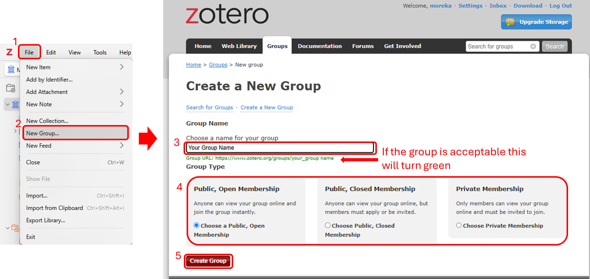
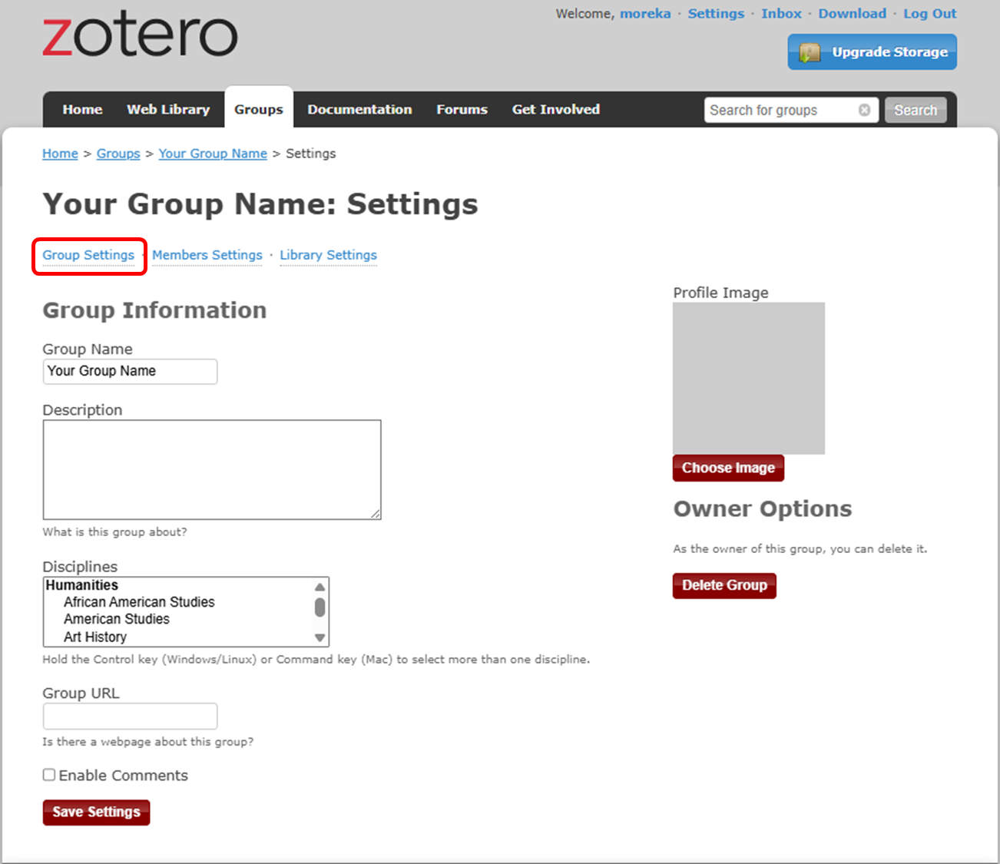
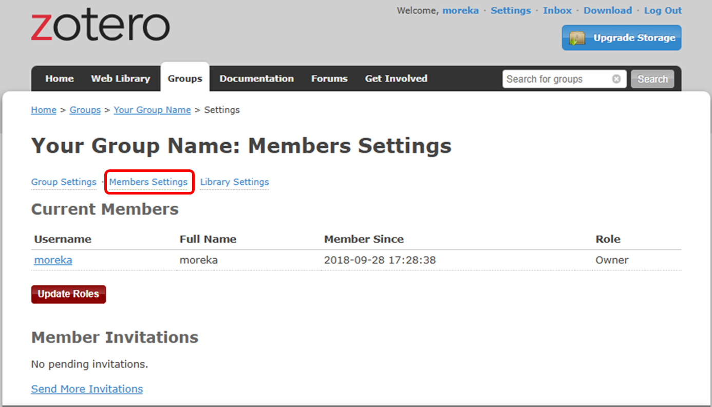
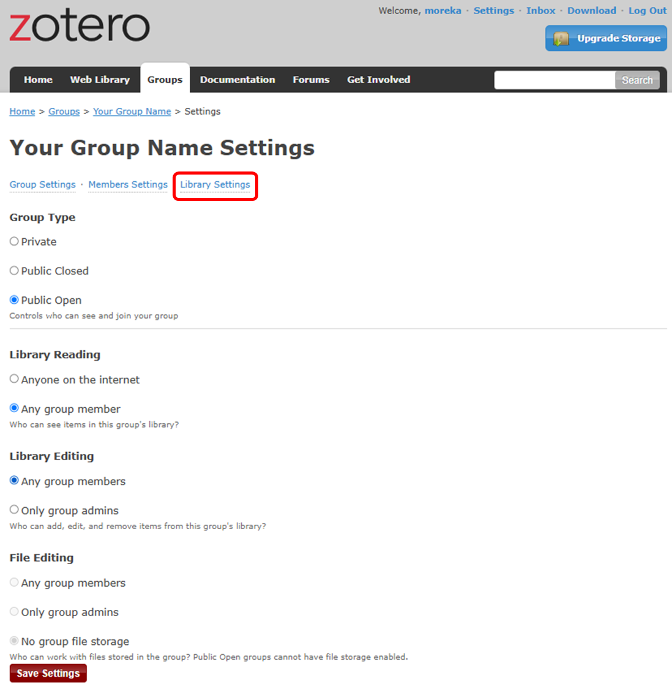
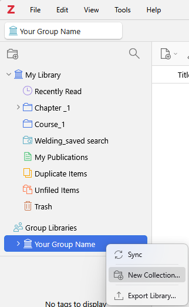

# Collaboration Using Zotero Groups
{: .no_toc }

  

    Table of contents
  

  {: .text-delta }
1. TOC
{:toc}

Zotero groups provide a powerful way to share collections with a class,
work closely with colleagues on a project, keep track of conversations
in your field more broadly, and keep tabs on what people at your
institution or in your department are working on. There is no limit on
how many members may join your groups, and your full storage
subscription is always available to your personal and group libraries.

Group Libraries are separate from your personal My Library, so you can
also use Zotero groups as a way to keep separate libraries within one
Zotero profile.

## **Creating Groups[\#](https://www.zotero.org/support/groups#creating_groups)**

To create a Zotero group in the Zotero Desktop App, go to File → New
Group... Alternatively, you can click “Create a New Group**”** on the
[Groups landing page](https://www.zotero.org/support/groups) on
Zotero.org. Then, select your preferred **Group Type** and click
**“Create Group.”**

## **Group Types[\#](https://www.zotero.org/support/groups#group_types)**

### **Private Groups[\#](https://www.zotero.org/support/groups#private_groups)**

- Private groups provide a means of collaboration among group members
  without creating any public face for the group online.

- Only group members and users invited to join the group are able to see
  the group’s page.

- Private groups are completely hidden from group searches. They are not
  shown on members’ public profile pages and will not appear in search
  engine results.

- If administrators enable file sharing, group members can access and
  share files in addition to references.

### **Public, Closed Membership[\#](https://www.zotero.org/support/groups#public_closed_membership)**

- Closed-membership groups are useful for creating a controlled group
  environment with a public presence. This allows a group to publicly
  present its work and sources, or develop new membership in a
  controlled fashion.

- Anyone can view the group page, but the only way to join the group is
  by invitation or by requesting an invitation.

- If the group has a library, administrators can choose to show or hide
  the library from non-members.

- If administrators enable file sharing, group members can access and
  share files in addition to references.

### **Public, Open Membership[\#](https://www.zotero.org/support/groups#public_open_membership)**

- Open public groups are useful for the broadest discussion and
  collaboration.

- The group page is public, and anyone who wants to can join instantly.

- If the group has a library, administrators can choose to show or hide
  the library from non-members.

- Open public groups do not allow file sharing.

## **Group Settings[\#](https://www.zotero.org/support/groups#group_settings)**

### **Group Profile Settings[\#](https://www.zotero.org/support/groups#group_profile_settings)**

This page allows you change the group’s name, description, academic
discipline, and group type (private/public, open/closed). You can also
add a group profile picture, give a URL for a webpage about the group,
and enable/disable comments.

To transfer group ownership to another user, use the “Transfer
Ownership” option from this page. Only the group owner can initiate
transferring ownership. If the member offered accepts ownership, they
will become the new group owner (and any group file storage will start
to count against their storage quota).

Group owners can also delete the group from this page.

### **Members Settings[\#](https://www.zotero.org/support/groups#members_settings)**

There are three roles for users in groups: regular members,
administrators, and group owners. Administrators can change a group’s
public/private status, members’ roles, and group library settings. Group
owners have all the same privileges as administrators, but can also
delete the group or transfer ownership to another member.

If group file storage is enabled, it will count against the owner’s
storage quota. Other group members’ storage quotas will not be affected
by the group files.

If this is a group for a team, lab, or organization, we recommend
setting up a separate account for the team to function as the owner of
the group, with at least two people knowing the login information. This
way, you will not be locked out of the group if the group owner were to
leave the team or organization.

To invite new group members, click the “Send More Invitations” link at
the bottom of this page. Pending invitations can also be cancelled from
this page.

### **Library Settings[\#](https://www.zotero.org/support/groups#library_settings)**

**Group Type** The group type (private/public, open/closed) can be
changed from this page.

**Library Reading** (Who can see items in this group’s library?):

- Anyone on the internet

- Any group member


**Library Editing** (Who can add, edit, and remove items from this
group’s library?):

- Any group member


- Only group admins

**File Editing** (Who can work with files stored in the group? Public
Open groups cannot have file storage enabled.):

- Any group member


- Only group admins

- No group file storage

## **Interact With Groups Through the Zotero Client[\#](https://www.zotero.org/support/groups#interact_with_groups_through_the_zotero_client)**

If you have [<u>enabled data
syncing</u>](https://www.zotero.org/support/sync#data_syncing) and are a
member of a group with an enabled library, the group library will appear
in Zotero’s left pane. Items can be dragged into a group from My Library
or another group and viewed or edited by other group members, if their
permissions allow it. To create a collection, right-click on a group
library and select “New Collection…” or “New Saved Search…”.

Note that group libraries are wholly separate from My Library. Any items
dragged into them are separate copies and changes to the items will not
be reflected in your own copy of the item until you drag it back into My
Library.

