# Notes and Annotations
{: .no_toc }

  

    Table of contents
  

  {: .text-delta }
1. TOC
{:toc}

In addition to items and file attachments, you can also store notes in
your Zotero library: child notes, which belong to a specific item, and
standalone notes. Notes are
[<u>synced</u>](https://www.zotero.org/support/sync) along with item
metadata; they don’t count against your Zotero [<u>file storage
quota</u>](https://www.zotero.org/support/storage).

# Child Notes[\#](https://www.zotero.org/support/notes#child_notes)

To create a child note, select an item in the center pane. Then, either
click the “New Note” button at the top of the center pane
() and select “New Item Note”,
or select the “Notes” icon
()in the right-hand pane and
click the plus icon
(). You can also right-click
an item and select “Add Note”.

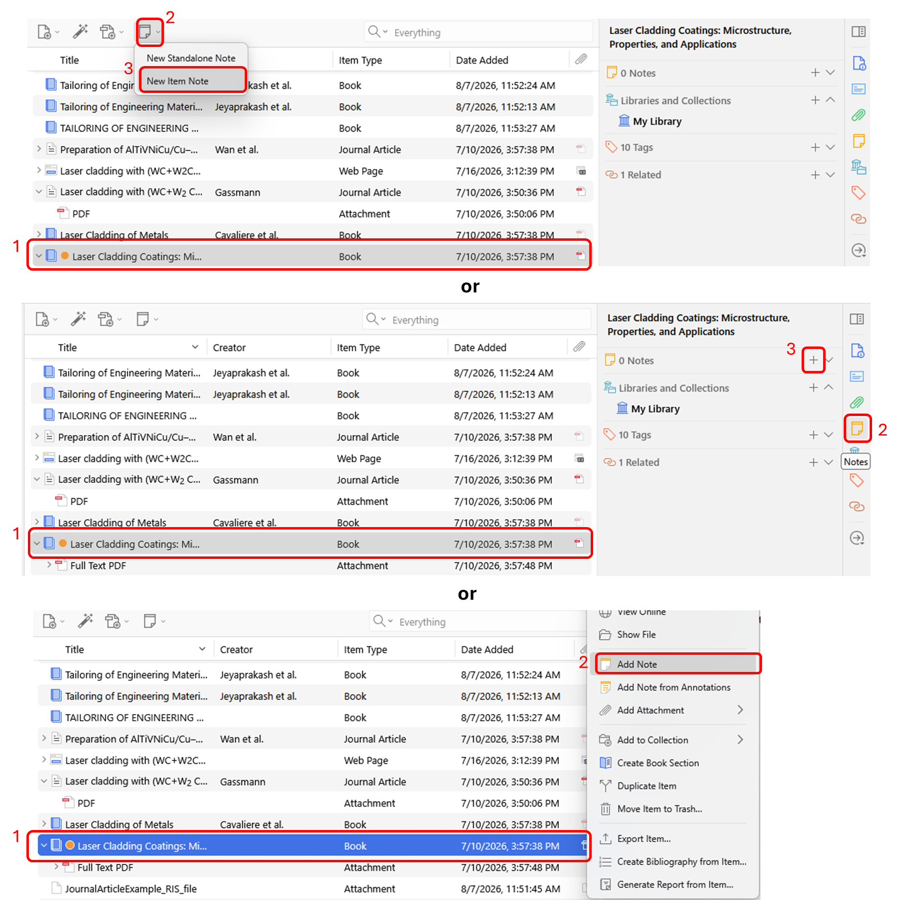

A note will be created as an
attachment to the item (it will also show up under the “Notes”), and a
note editor will appear in the right-hand pane. You can create a
dedicated window for the note editor by clicking the “Edit in a separate
window” button at the bottom of the editor. Text in notes is saved as
you type.

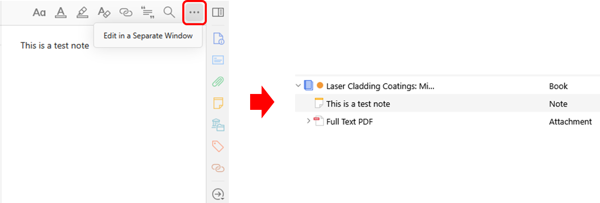

# Standalone Notes[\#](https://www.zotero.org/support/notes#standalone_notes)

Standalone notes work the same as child notes, but are not directly
related to any item in your library. Standalone notes will appear
alongside any other items in your library. To create a standalone note,
click the “New Note”
() button and select “New
Standalone Note”.

# Tagging and Relating[\#](https://www.zotero.org/support/notes#tagging_and_relating)

As with any other item in Zotero, notes or standalone notes can be
[<u>tagged</u>](https://www.zotero.org/support/collections_and_tags) and
[<u>related</u>](https://www.zotero.org/support/related) to other items.
Both features can be accessed via the bottom of the note editor.

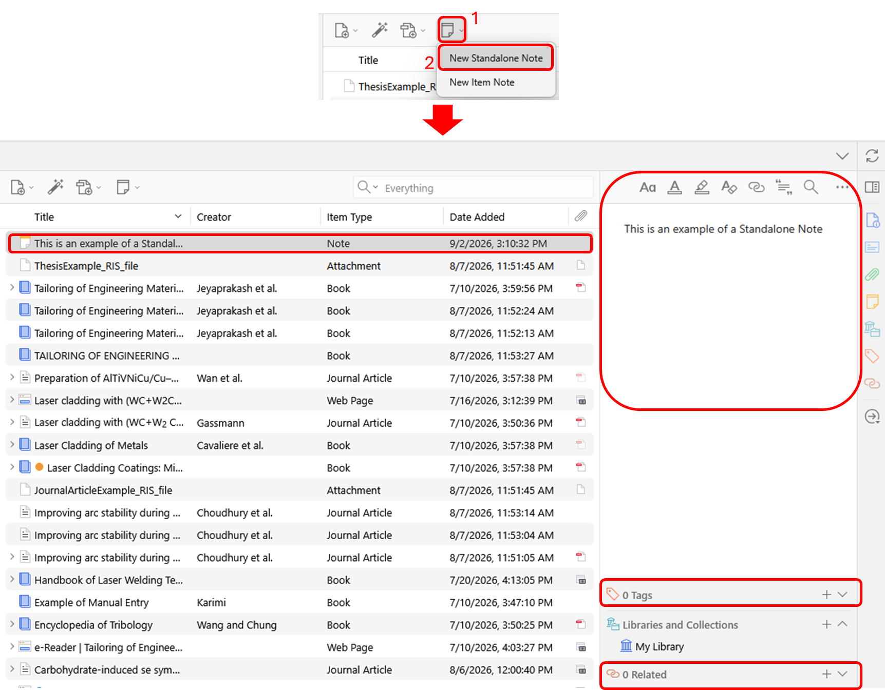

# Searching Notes[\#](https://www.zotero.org/support/notes#searching_notes)

Notes can be searched via the general Zotero
[<u>search</u>](https://www.zotero.org/support/searching). You can
search text within a note using the note editor’s “Find and Replace”
button or Ctrl/Cmd-F.

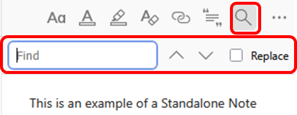

# Images in Notes[\#](https://www.zotero.org/support/notes#images_in_notes)

You can embed images into Zotero notes by dragging them from your
filesystem or, in some cases, by pasting them in. Embedded images sync
between devices and count against your Zotero Storage quota.

# Creating Annotations[\#](https://www.zotero.org/support/pdf_reader#creating_annotations)

**Highlights and Underlines[\#](https://www.zotero.org/support/pdf_reader#highlights_and_underlines)**

The reader supports two highlighting/underlining modes. You can use
whichever mode works best for your workflow. In the default, unlocked
mode, with nothing selected in the annotation toolbar, whenever you
select text in the document, a popup will appear with a selection of
colors, and you can click a color to create a highlight or underline on
the selected text.

To quickly make many highlights or underlines, you can turn on locked
mode: click the highlight or underline tool in the toolbar, and then
choose a color using the color-picker button. Then, every time you
select text in the document, a highlight or underline will be
automatically created in the color you’ve picked.

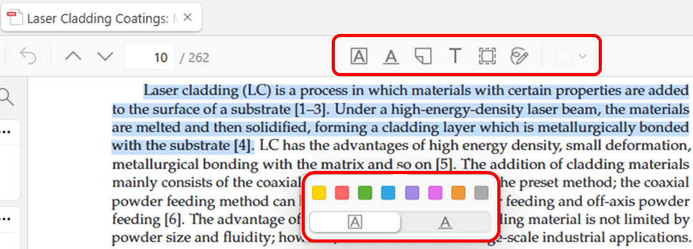

# Adding Annotations to Notes[\#](https://www.zotero.org/support/pdf_reader#adding_annotations_to_notes)

You can add annotations to notes in various ways. Annotations added to
notes will automatically include links back to the PDF page as well as
citations that you can later add to a Word, LibreOffice, or Google Docs
document with one of the word processor plugins.

## In the PDF reader[\#](https://www.zotero.org/support/pdf_reader#in_the_pdf_reader)

You can easily add annotations to notes right from the PDF reader.
First, use the Notes button in the top-right corner to open the Notes
pane, where you can create a new note or open an existing note.

To create a new note from all annotations in the current PDF, click one
of the “+” buttons and select Add Item Note from Annotations or Add
Standalone Note from Annotations.

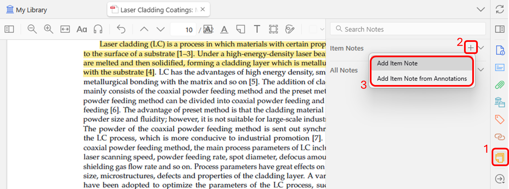

If you already have a note open in the Notes pane, you can drag
individual annotations from the PDF or from Annotations tab in the
left-hand sidebar as you type your note. Alternatively, you can select
one or more annotations in PDF or in the Annotations tab of the
left-hand sidebar, right-click one of the annotations, and select Add to
Note.

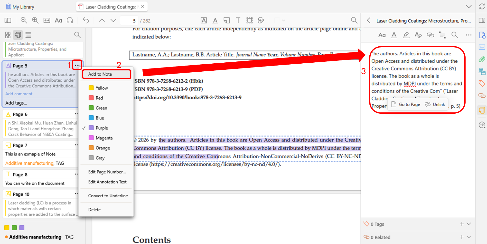

You can also drag annotations from the PDF reader to a note that’s
opened in a separate window. If you’re sure you won’t use a quote more
than once, it’s also possible to add quotes to Zotero notes without
creating an annotation first. Simply select text in the PDF and drag it
to an open Zotero note.

## In the items list[\#](https://www.zotero.org/support/pdf_reader#in_the_items_list)

You can create a child note from all annotations in a PDF by
right-clicking on the parent item in the items list and choosing Add
Note from Annotations.

You can also create a standalone note with annotations from multiple
items by selecting the parent items, right-clicking, and choosing Create
Note from Annotations.

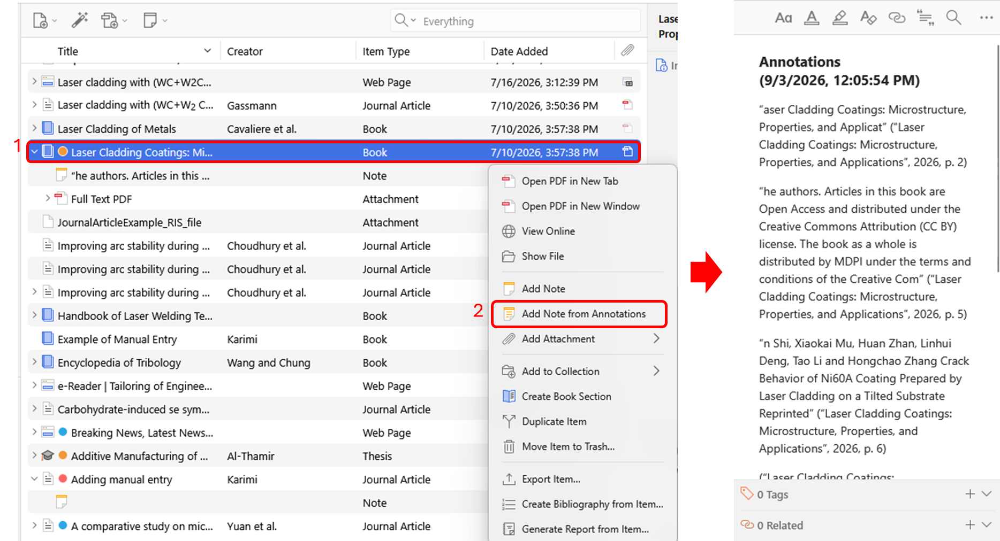

# Customizing Annotations in Notes[\#](https://www.zotero.org/support/pdf_reader#customizing_annotations_in_notes)

You can customize how annotations are added to notes by using [<u>note
templates</u>](https://www.zotero.org/support/note_templates).

# Working with Annotations in Notes[\#](https://www.zotero.org/support/pdf_reader#working_with_annotations_in_notes)

## Viewing an Annotation in Context[\#](https://www.zotero.org/support/pdf_reader#viewing_an_annotation_in_context)

When you add an annotation to a note, it will add both an annotation and
a citation by default.

To view the annotation in context, click the annotation and click “Show
on Page” in the popup that appears. This will open the original PDF in
either the built-in PDF reader or an external PDF reader if you’ve
configured one in the General pane of the preferences. When possible,
Zotero will open the PDF to the page where the annotation was made —
this works for the built-in PDF reader and most, but not all, popular
external PDF readers (e.g., Acrobat on Windows, Preview on macOS, evince
on Linux).

To view the associated item in your library, click the citation and
select “Show Item”.

## Displaying Annotation Colors[\#](https://www.zotero.org/support/pdf_reader#displaying_annotation_colors)

To show annotation colors in your note, click the “…” button in the
top-right corner of the note editor and select “Show Annotation Colors”.
You can remove colors later with “Hide Annotation Colors”.

## Hiding or Showing Citations in the Note[\#](https://www.zotero.org/support/pdf_reader#hiding_or_showing_citations)

To hide or show all citations in a note, click the “…” button in the
top-right corner of the note editor and select “Hide Annotation
Citations” or “Show Annotation Citations”.

You can hide an individual citation by clicking on it in the editor and
selecting “Hide Citation” from the popup, or simply by deleting the
citation completely. You can add the citation back at any time by
clicking on the highlighted text and selecting “Add Citation” from the
popup or by using “Show Annotation Citations” in the “…” menu.

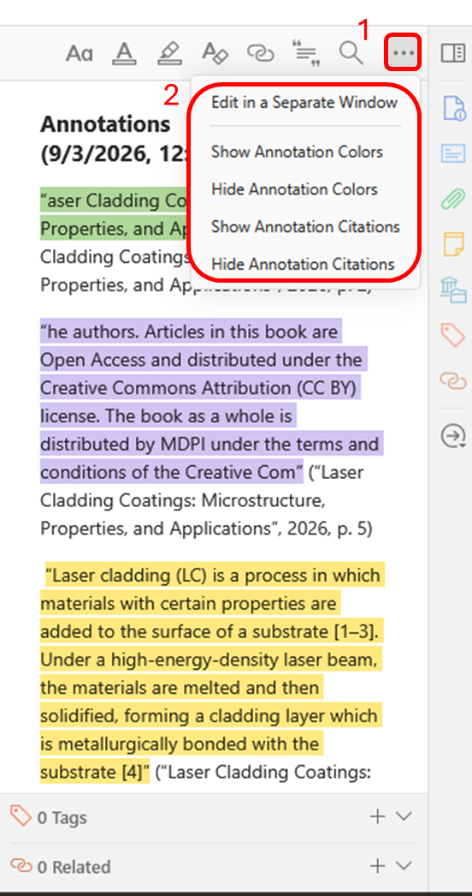

# Using an External PDF Reader[\#](https://www.zotero.org/support/pdf_reader#using_an_external_pdf_reader)

If you’d prefer to open PDFs in an external PDF reader, you can choose
one from the General pane of the Zotero preferences.

To open a single PDF in an external reader, right-click on the item and
choose Show File, and then open the PDF from your OS file manager. Some
changes you make in external PDF readers will cause problems in the
built-in reader — e.g., adding, deleting, reordering, or rotating pages
will cause annotations to appear on the wrong page or in the wrong
position. (Pages can be deleted or rotated from the Annotations tab in
the Zotero reader sidebar.)

Note that annotations created in the built-in PDF reader are stored in
the Zotero database, so they won’t be visible in external PDF readers
unless you export a PDF with embedded annotations. See
[<u>Annotations in
Database</u>](https://www.zotero.org/support/kb/annotations_in_database)
for more info.

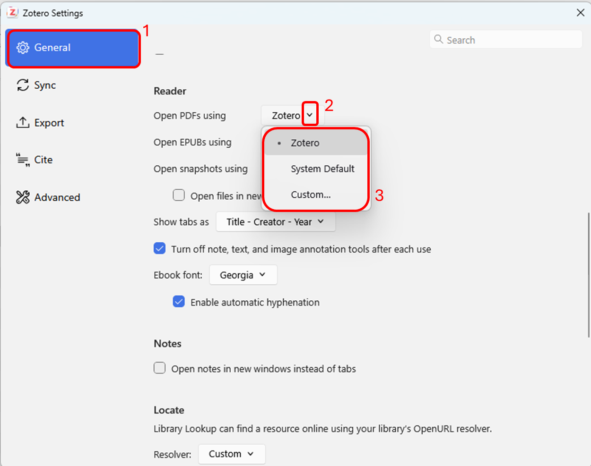

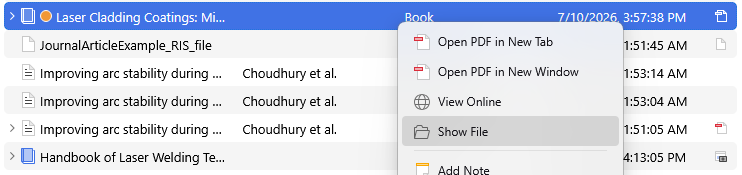
