# Tags[\#](https://www.zotero.org/support/collections_and_tags#tags)
{: .no_toc }

  

    Table of contents
  

  {: .text-delta }
1. TOC
{:toc}

## The Tag Selector[\#](https://www.zotero.org/support/collections_and_tags#the_tag_selector)

The tag selector is located at the bottom of the left Zotero pane. It
shows all the tags that have been assigned to the items currently shown
in the center pane (i.e., items in the currently selected collection
that match the current search). To show all of the tags present in the
library, click the filter button
(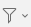) in the lower-right corner
of the tag selection and choose “Display All Tags in This Library”. Tags
not assigned to currently shown items are greyed out. You can filter
items by their tags by clicking on one more tags in the tag selector.
Only items that have all of the selected tags will be shown in the
center pane. As you apply filters, the list of tags in the tag selector
will be updated to show only the tags assigned to currently visible
items. Clicking on a tag again will deselect it. To deselect all tags at
once, click the filter button and choose “Deselect All”.

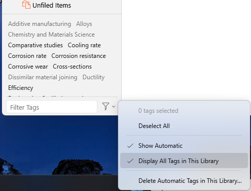

The filter box at the bottom of the tag selector can be used to search
for tags. Type in the search box to see all tags that match. To go back
to viewing all the tags in the collection, press the Escape key or click
the “X” button on the right side of the search box.

## Adding/Removing Tags to/from Items[\#](https://www.zotero.org/support/collections_and_tags#adding_tags_to_items)

To add a tag to an item, select the item in the center Zotero pane, and
then click the Tags icon in the right-hand pane. Click the Add button,
type the tag name, and type Enter/Return. You can rename a tag by
clicking on it and typing the new name. Once you have added the tag it
will also appear in the tag selector in the bottom left.

As you type, you will be shown a list of matching existing tags. You can
choose a suggested tag using the up and down arrow keys and insert it by
pressing Tab or Enter/Return on your keyboard.

You can also drag items to a tag in the tag selector in the bottom left
to quickly add the tag to all of those items.

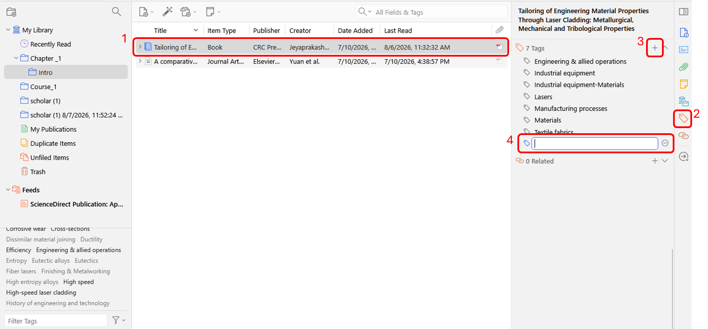

To remove a tag from an item, select the item in the items list, click
the Tags tab in the right-hand pane, and click the “-” (minus) button
next to the tag you want to remove.

You can also hold Cmd (Mac) or Shift (Windows/Linux) while dragging
items to a tag in the tag selector in the bottom left to remove the tag
from all of those items.

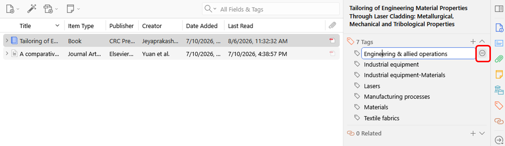

or

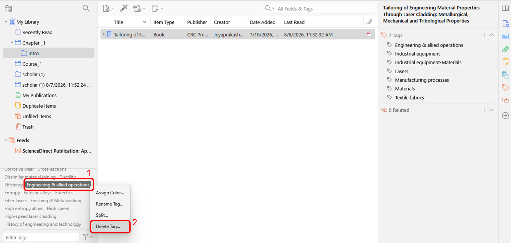

## Bulk Editing Tags[\#](https://www.zotero.org/support/collections_and_tags#bulk_editing_tags)

You can use the tag selector to globally rename and delete tags. To
rename a tag across all items it is assigned to, right-click the tag in
the tag selector and choose “Rename Tag…”. To delete a tag from all
items, right-click the tag and choose “Delete Tag…”. You can merge tags
by renaming one to have the same name as the other.

## Colored Tags[\#](https://www.zotero.org/support/collections_and_tags#colored_tags)

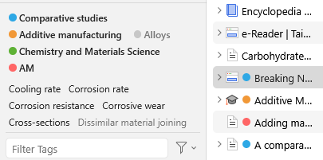

Colored tags appear as small colored squares next to items’ titles in
the center pane. Colored tags make it easy to quickly scan your library
for tags that have a certain tag. Colored tags are shown at the top of
the tag selector and are always visible, even if not assigned to any
visible items.

Some may use colored tags for “to read” or “favorite” items.

You can assign a color to a tag by right-clicking on it and choosing
“Assign Color…” In the popup window, select a color from the dropdown
box and click “Set Color”. You can remove a color from a tag by
right-clicking, choosing “Assign Color…”, and clicking “Remove Color”.

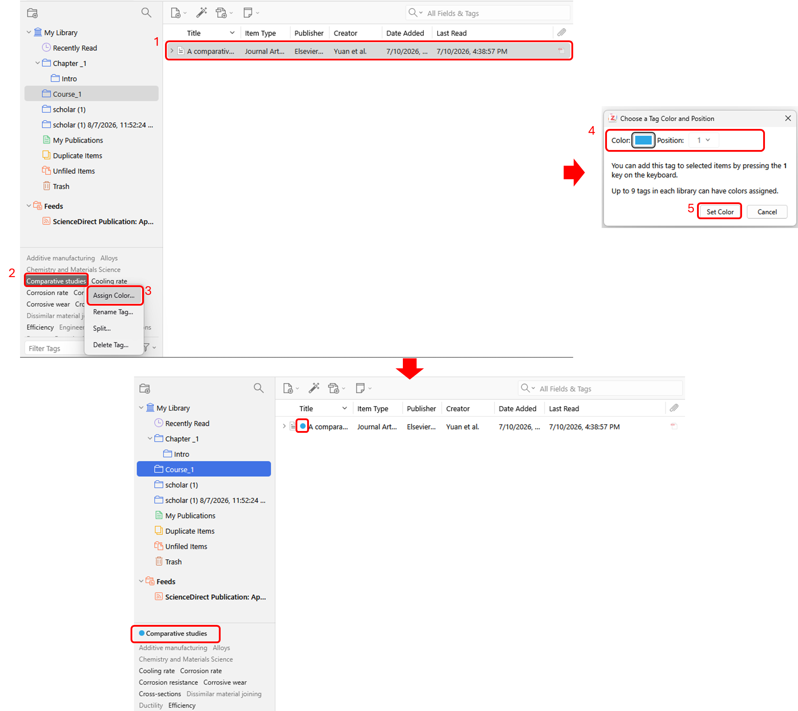

Each colored tag is also assigned a number, corresponding to its
position at the top of the tag selector. You can quickly add or remove a
colored tag from selected items by typing the corresponding number key
on your keyboard. You can change a colored tag’s number by
right-clicking on it, choosing “Assign Color…”, and choosing a new
position.

If you use an emoji in a colored tag, the emoji will be displayed
directly in place of the colored square. The tag will otherwise behave
like a colored tag, showing at the top of the tag selector and being
assignable with a number key. Up to 9 tags can be assigned colors and
numbers.

## Automatic Tags[\#](https://www.zotero.org/support/collections_and_tags#automatic_tags)

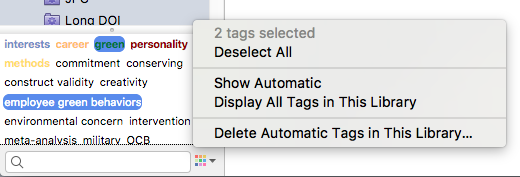

When items are saved to a Zotero library [<u>from the
web</u>](https://www.zotero.org/support/adding_items_to_zotero#web_translators),
tags are sometimes automatically added to items. For example, OPAC
library catalogs provide subject headings for their records, which are
saved as Zotero tags. Automatic tags behave the same as manually added
tags but are marked by a black icon in the “Tags” tab of the right-hand
Zotero pane (versus the blue icon for regular tags).

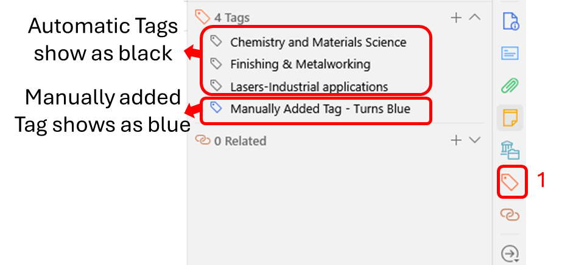

Automatic tags can be hidden from the tag selector by clicking the
multi-color button in the lower-right corner of the tag selector and
unchecking “Show Automatic”. You can delete all automatic tags from a
library by clicking “Delete Automatic Tags in This Library”.

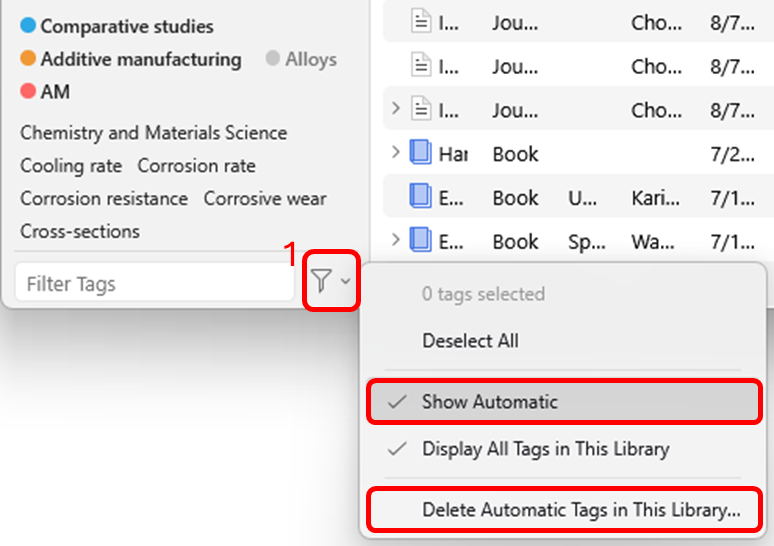

To prevent Zotero from adding automatic tags, uncheck “Automatically tag
items with keywords and subject headings” in the
[<u>General</u>](https://www.zotero.org/support/preferences/general)
pane of Zotero preferences.

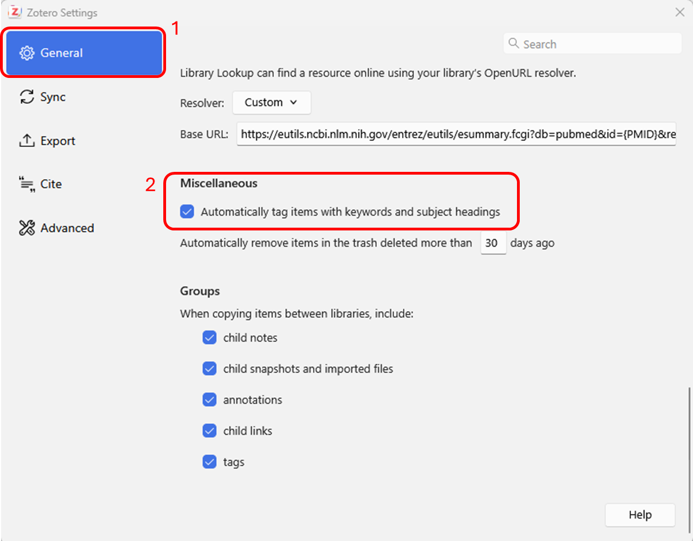

# Related Items

In addition to [<u>collections and
tags</u>](https://www.zotero.org/support/collections_and_tags), a third
way to express relationships between items is by setting up “relations”.
Relations can set up between any pair of items in a library (it is not
possible to relate items from different libraries).

To create a relation, select an item in the center pane and go to the
“Related” tab of the right pane. Click the “Add” button, and select one
or more items from the same library in the pop-up window (hold down Ctrl
or Shift \[Windows/Linux\] or Cmd or Shift \[Mac\] to select multiple
items) and click “OK”. The selected items will now show up as related
items in the “Related” tab, and clicking an item will take you straight
to that item.

Note that when you relate item A to B, B will be automatically related
to A. But relations are not transitive: relating A to B, and B to C,
will not automatically relate A to C.

Some suggestions of how you could use this feature:

- connect book chapters to their parent volume
- connect book reviews to the book reviewed
- connect different versions of a work (e.g., connecting a conference
  presentation that eventually became an article that eventually became
  a book)
- link associated items from different collections
- link items that form parts of a single work (e.g., articles in a
  series)
- connect standalone notes to the items they discuss
- link one item to another discussed in the Abstract or Notes fields
- link items that have similar comments in the Abstract or Notes fields

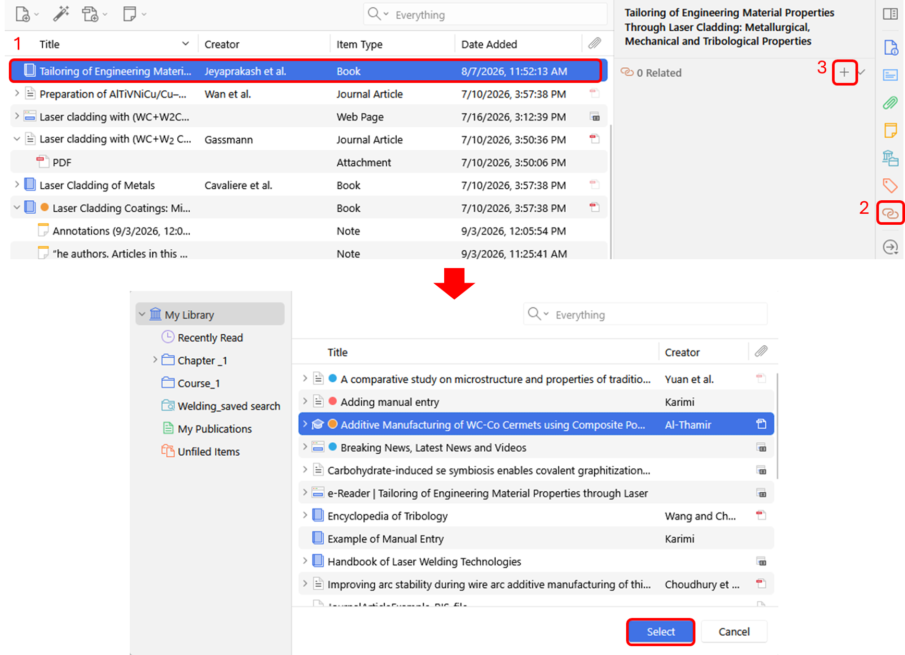
