{: .no_toc }

  

    Table of contents
  

  {: .text-delta }
1. TOC
{:toc}

Items in Zotero libraries can be organized with collections (the name
Zotero gives to folders) and tags.

Collections allow hierarchical organization of items into groups and
subgroups. The same item can belong to multiple collections and
subcollections in your library at the same time. Collections are useful
for filing items in meaningful groups (e.g., items for a particular
project, from a specific source, on a specific topic, or for a
particular course). You can import items directly to a specific
collection or add them to collections after they are already in your
library.

Tags (often called “keywords” in other contexts) allow for detailed
characterization of an item. You can tag items based on their topics,
methods, status, ratings, or even based on your own workflow (e.g.,
“to-read”). Items can have as many tags as you like, and you can filter
your library (or a specific collection) to show items having a specific
set of one or more tags.

Tags are portable, but collections are not. Copying items between Zotero
libraries (My Library and group libraries) will transfer their tags, but
not their collection placements. Both organizational methods have unique
advantages and features. Experiment with both to see what works best for
your own workflow.

# Collections[\#](https://www.zotero.org/support/collections_and_tags#collections)

It is important to understand that items can belong to multiple
collections and subcollections. Adding an item to multiple collections
does not duplicate the item. In this sense, collections are more like
music playlists than folders in your computer filesystem. Just as a
single song can be added to more than one playlist, a single item in a
Zotero library can be added to multiple collections.

## Creating Collections[\#](https://www.zotero.org/support/collections_and_tags#creating_collections)

Click the “New Collection…” button
() above the left pane in
Zotero to add a new collection. You can also right-click on “My Library”
or the name of a Group library and choose “New Collection…” to add a new
collection. The new collection will appear as a folder under “My
Library” or the selected Group library.

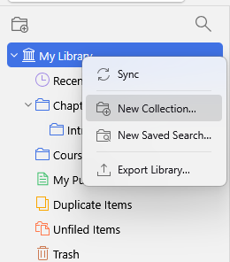

Subcollections can be created by dragging and dropping an existing
collection onto another collection or by right-clicking a collection and
choosing “New Subcollection…”. You can convert a subcollection into a
top-level collection by dragging it to the library root (e.g., “My
Library”).

You can drag collections between Zotero libraries in the left pane. If
you have editing privileges for the destination library, the collection
(and all of its items and subcollections) will be added to the
destination library.

## Adding Items to Collections[\#](https://www.zotero.org/support/collections_and_tags#adding_items_to_collections)

New items are automatically saved into the collection selected at the
time. When saving from the browser, you can choose a different
collection from the popup after clicking the save button.

To add existing items in your library to a collection, select them in
the center pane and drag them onto the collection in the left pane. By
default, the items will be added to the new collection but won’t be
removed from their original location.

To *move* items between collections, hold down Cmd (Mac) or Shift
(Windows/Linux) when dragging items to the new collection. Remember that
the “My Library” view always shows all items in your library, so you
cannot “move” items out of this view. To see only items that do not
belong to any collection in your library, open the [<u>Unfiled
Items</u>](https://www.zotero.org/support/collections_and_tags#unfiled_items)
special collection.

## Renaming Collections[\#](https://www.zotero.org/support/collections_and_tags#renaming_collections)

Right-click on the collection and choose “Rename Collection…” to give a
collection a new name. Collections are sorted alphabetically in your
library. You can use punctuation marks to sort collections to the top of
the list.

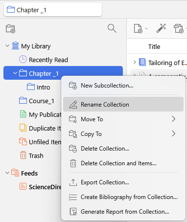

## Deleting Collections[\#](https://www.zotero.org/support/collections_and_tags#deleting_collections)

Right-click on the collection and choose “Delete Collection…” to remove
a collection from your library. Deleting a collection **does not
delete** the items in the collection. Items are still accessible by
clicking on My Library or the Group library name.

Deleting a collection will also delete its subcollections (but not the
items in them).

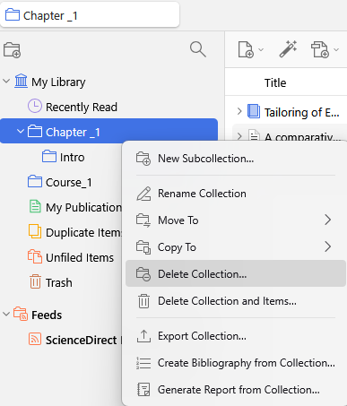

To delete both the collection and its items, right-click on the
collection and choose “Delete Collection and Items…”.

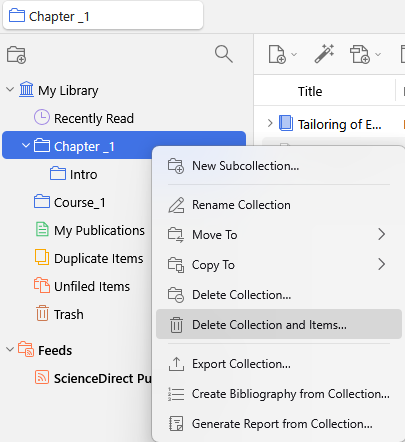

## Removing Items from a Collection[\#](https://www.zotero.org/support/collections_and_tags#removing_items_from_a_collection)

Select a collection in the left Zotero pane, then select the items in
the center pane that you want to remove from the collection. Press the
Delete key to remove the items from the collection. You can also
right-click the selected items and choose “Remove Item(s) from
Collection…”. This only removes the items from the selected collection,
not from “My Library” or any other collections.

To *delete* an item in a collection, select the items in the collection,
right-click on them, and choose “Move Item(s) to Trash…”. When “My
Library” or a Group library name is selected in the left Zotero pane,
pressing the Delete key will also move items to the trash. When a
collection or subcollection is selected, press Cmd/Ctrl-Delete to move
the items directly to the trash.

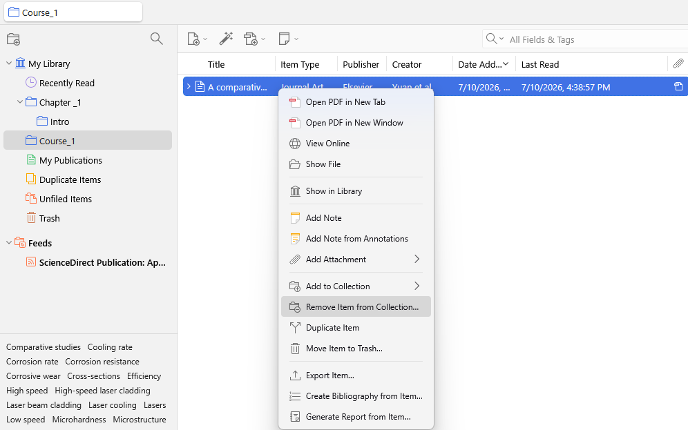

## Identifying Collections an Item is In[\#](https://www.zotero.org/support/collections_and_tags#identifying_collections_an_item_is_in)

Zotero 7 and higher versions include a section in the item pane showing
a list of collections an item is in. You can also select the item and
then hold down the Option key (macOS), Control key (Windows), or Alt
(Zotero 6)/Ctrl (Zotero 7) key (Linux). This will highlight all
collections that contain the selected item.

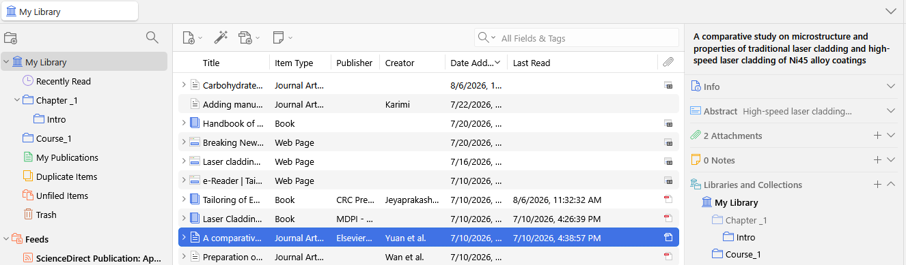

## Saved Searches[\#](https://www.zotero.org/support/collections_and_tags#saved_searches)

[<u>Saved
Searches</u>](https://www.zotero.org/support/searching#saved_searches)
are like smart collections. They automatically update to include all the
items in your library that meet the search criteria. For example, you
can create a “To Read” Saved Search with the criteria Tag is not read.
Then, opening the Saved Search will show you all of the items in your
library that you haven’t read yet (i.e., the ones without a “read” tag).
To mark an item as read, add the “read” tag to it.

| 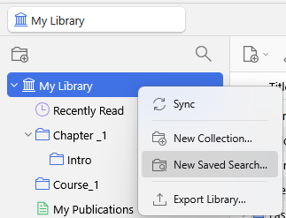 | 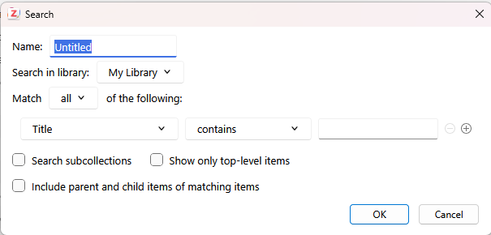 |
|----|----|

## 

## Special Collections[\#](https://www.zotero.org/support/collections_and_tags#special_collections)

Zotero has four special collections: “My Publications”, “Duplicate
Items”, “Unfiled Items”, and “Trash” which is listed on the left pane.

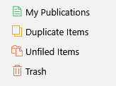

### My Publications[\#](https://www.zotero.org/support/collections_and_tags#my_publications)

The [<u>My
Publications</u>](https://www.zotero.org/support/my_publications)
special collection allows you to create a list of your own work and
share it publicly on your profile page on Zotero.org. You can add notes
to each item and even share PDFs or other files under a license of your
choice.

To add an item, first add it to your library; then drag it from your
library to “My Publications” to launch the My Publication wizard. You’ll
be able to choose whether to include attached notes and files. Only add
work you yourself have created, and only include files if you have the
rights to distribute them publicly and wish to do so.

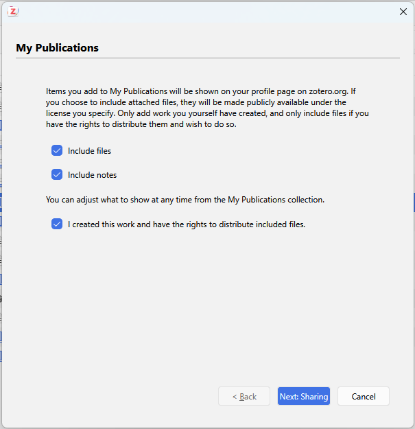

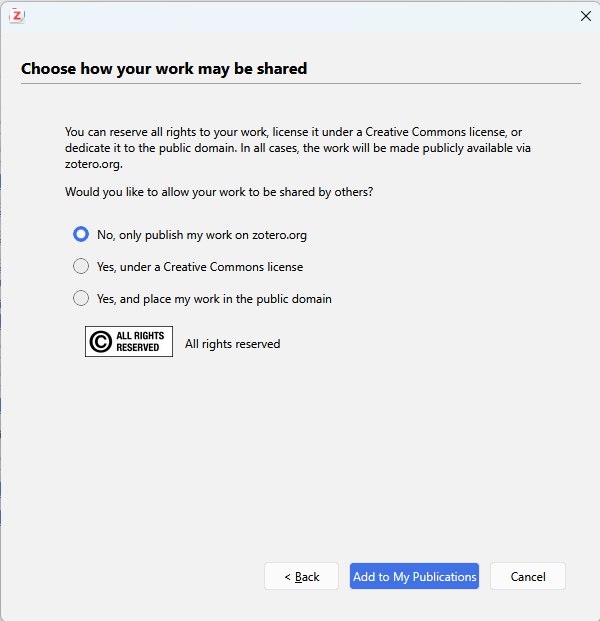

### Duplicate Items[\#](https://www.zotero.org/support/collections_and_tags#duplicate_items)

The [<u>Duplicate
Items</u>](https://www.zotero.org/support/duplicate_detection) special
collection displays items that Zotero has identified as potential
duplicates. As you build your Zotero library, you may occasionally add
the same item more than once. For example, you might save the same item
twice from a webpage or import an item that is already in your library.
You can use this collection to review and merge duplicate items.

#### Finding Duplicates[\#](https://www.zotero.org/support/duplicate_detection#finding_duplicates)

Clicking on the “Duplicate Items” collection in your library will show
the items Zotero thinks are duplicates in the center pane.

Zotero currently uses the the title, DOI, and ISBN fields to determine
duplicates. If these fields match (or are absent), Zotero also compares
the years of publication (if they are within a year of each other) and
author/creator lists (if at least one author last name plus first
initial matches) to determine duplicates. The algorithm will be improved
in the future to incorporate other fields.

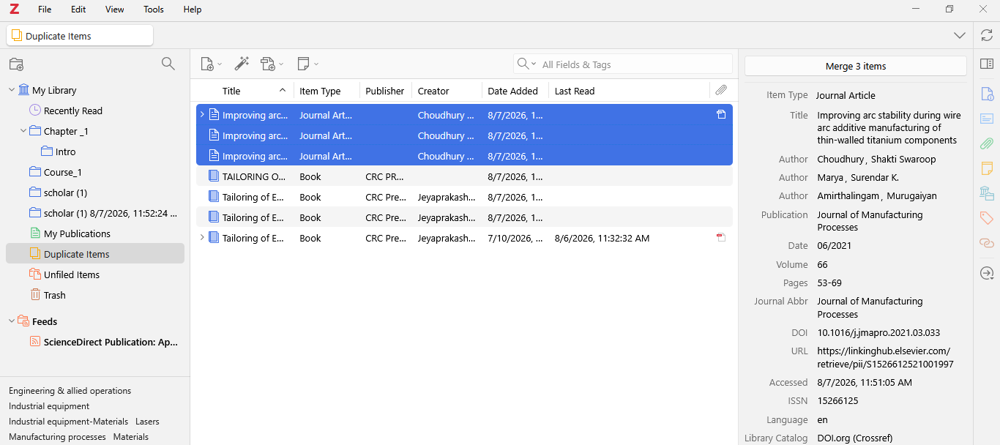

At this time, it is not possible to mark false positive matches as
non-duplicates. This functionality will be added in the future.

Note that duplicate detection only works *within a library*. Items in
different group libraries are [<u>separate
items</u>](https://www.zotero.org/support/groups#interact_with_groups_through_the_zotero_client).
They won’t show up in the “Duplicate Items” collection of any one of the
libraries.

#### Merging Duplicates[\#](https://www.zotero.org/support/duplicate_detection#merging_duplicates)

You should always resolve duplicate items by merging them, rather than
deleting one of the duplicates. Merges will retain all of the
collections and tags of the merged items; deleting one item will lose
these data. Merges are also automatically recognized by the [<u>word
processor
plugins</u>](https://www.zotero.org/support/word_processor_integration)
and don’t affect your automatically generated citations and
bibliographies.

To merge items in the “Duplicate Items” collection, select an item in
the center pane. Zotero will automatically co-select the other items
that it thinks are duplicates. Click the “Merge \<number\> Items” button
in the right pane to merge the items. If the item fields don’t match
completely, you can select one item to be the “master” from the list at
the top of the right pane, then select alternative versions of
mismatched fields using the icons to the right of each field.

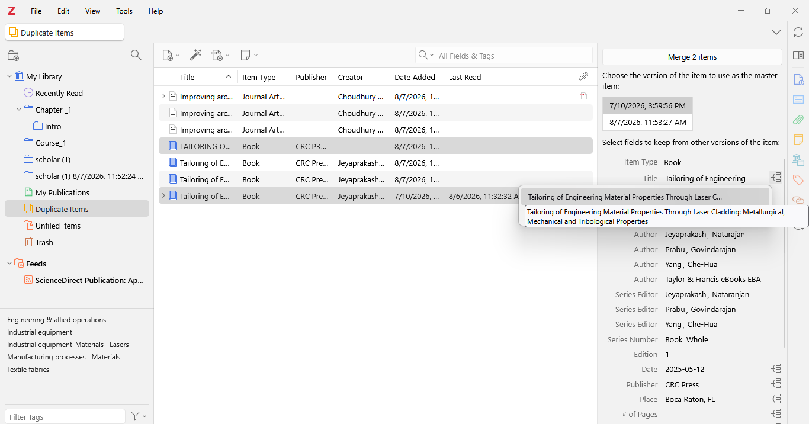

It may be easier to see which items are selected if you [<u>sort the
items by Title</u>](https://www.zotero.org/support/sorting). You can
select a single item in the “Duplicate Items” view by holding down
Alt/Option while clicking. You can de-select an item from a set of
duplicates by holding down Ctrl (Windows/Linux) or Cmd (Mac) while
clicking.

You can also select a group of two or more items *of the same item type*
anywhere in your Zotero library, right-click, and select “Merge Items…”
from the context menu.

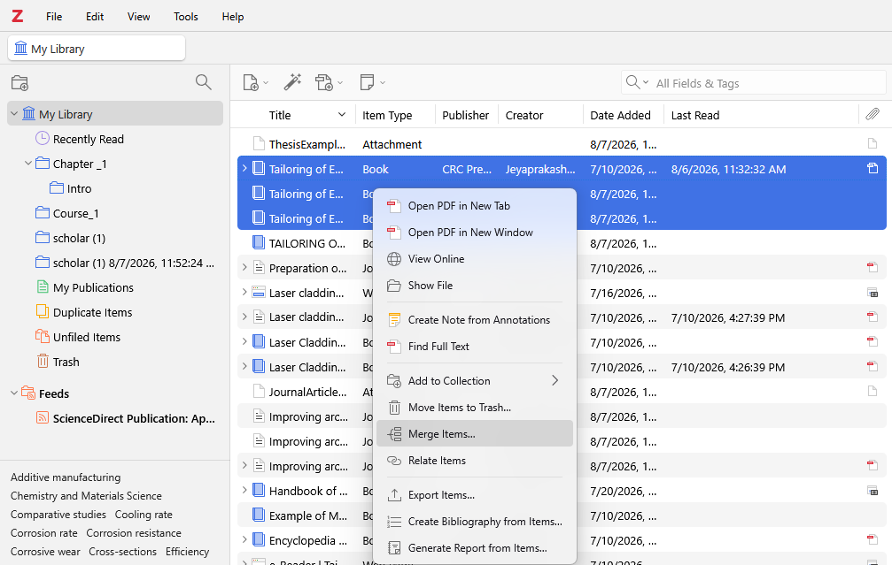

### Unfiled Items[\#](https://www.zotero.org/support/collections_and_tags#unfiled_items)

Items that are not in any collection can be found in the “Unfiled Items”
special collection at the bottom of the collections list in the left
Zotero pane. If the “Unfiled Items” collection is not visible,
right-click on “My Library” or the Group library name and choose “Show
Unfiled Items”.

### Trash[\#](https://www.zotero.org/support/collections_and_tags#trash)

When you delete an item by pressing Delete (Cmd/Ctrl-Delete in a
collection) or by right-clicking and choosing “Move Item(s) to Trash”,
they are moved to the Trash special collection. By default, items remain
in the Trash for 30 days (you can adjust this period in the [<u>General
pane</u>](https://www.zotero.org/support/preferences/general) of Zotero
preferences; Click Edit --\> Settings --\> General Pane), after which
they are deleted permanently. You can restore an item from the Trash to
your library by selecting it in the Trash and clicking the “Restore to
Library” button (or by right-clicking and choosing “Restore to
Library”). You can delete an item permanently by clicking the “Delete
Permanently…” button (or by right-clicking and choosing “Delete Item…”.

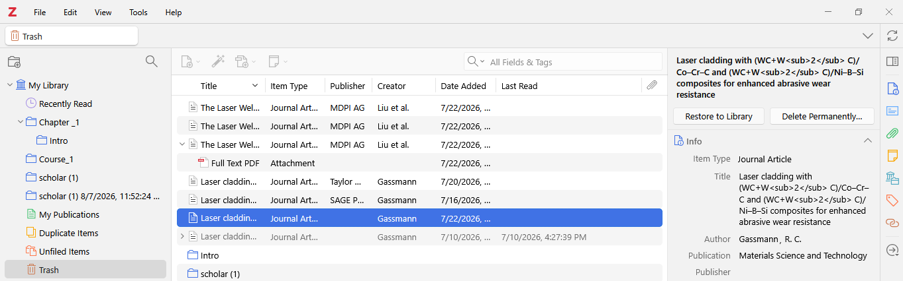Or

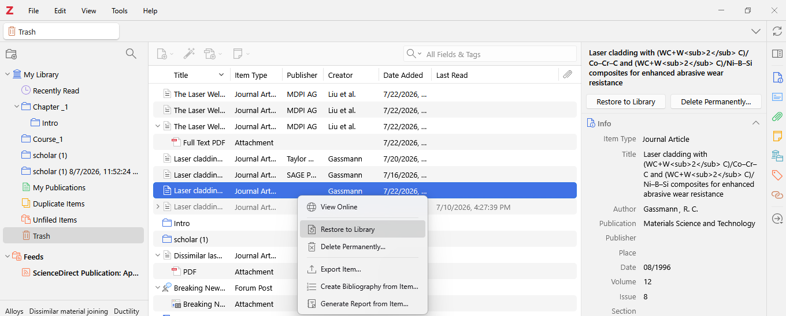

To update the preferences

| 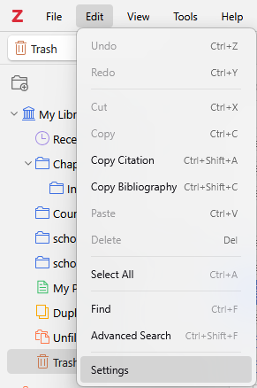 | 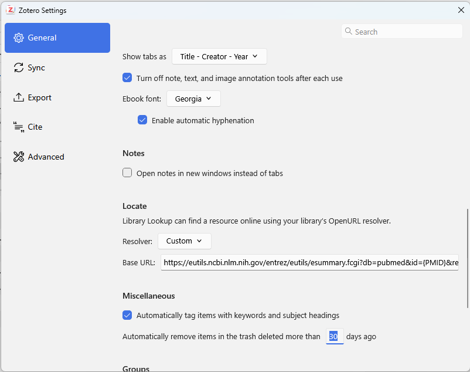 |
|----|----|

## Show Items from Subcollections[\#](https://www.zotero.org/support/collections_and_tags#show_items_from_subcollections)

By default, items added to a subcollection do not automatically appear
in parent collections. This can be changed by toggling “Show Items from
Subcollections” in the View menu. This setting is not currently
available in the online library.

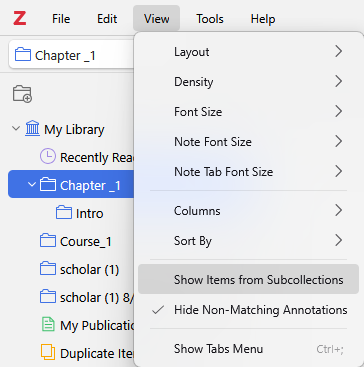
