# Supplementary Information
{: .no_toc }

  

    Table of contents
  

  {: .text-delta }
1. TOC
{:toc}

# Quick Search[\#](https://www.zotero.org/support/searching#quick_search)

Quick searches provide a fast way to find items in a library or
collection.

## Running a Quick Search[\#](https://www.zotero.org/support/searching#running_a_quick_search)

To begin searching, click inside the search box at the top-right of the
center pane (or type Ctrl/Cmd-F) and start typing your search terms. As
you type, only those items in the center column that match the search
terms will remain.

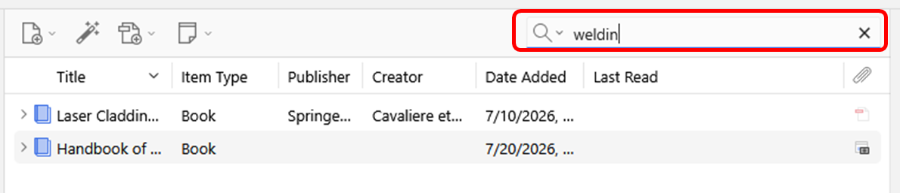

## Quick Search Options[\#](https://www.zotero.org/support/searching#quick_search_options)

Quick search can be used in three different modes:

- “Title, Year, Creator” - matches against these three fields, as well
  as publication titles

- “All Fields & Tags” - matches against all fields, as well as tags and
  text in notes

- “Everything” - matches against all fields, tags, text in notes, and
  indexed text in PDFs

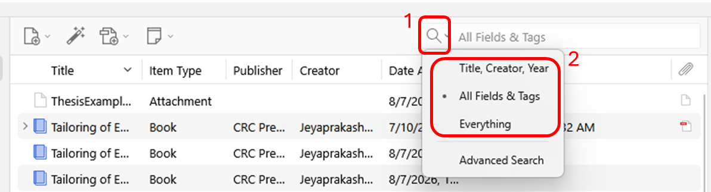

## Speeding Up Quick Searches[\#](https://www.zotero.org/support/searching#speeding_up_quick_searches)

By default, the quick search searches automatically as you type. In very
large libraries, this can result in a slow search experience. To speed
things up, type a quotation mark (") mark at the beginning of the search
field. This causes the search to start only when you type Enter/Return.

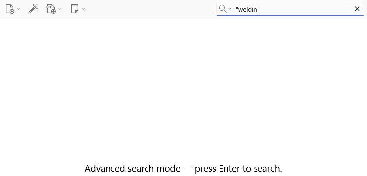

# Advanced Search[\#](https://www.zotero.org/support/searching#advanced_search)

Advanced searches offer more and finer control than quick searches, and
allow you to make [saved searches](#saved-searches-1).

## Running an Advanced Search[\#](https://www.zotero.org/support/searching#running_an_advanced_search)

To open the Advanced Search window, click on the magnifying glass icon
() at the top of the center
pane and select “Advanced Search”. In this window, you can filter items
by the content of specific fields or by other properties, like item type
or the collection an item belongs to. Multiple filters can be set up by
clicking the plus button.

Set the library to search in by using the “Search in library:” option at
the top of the window. It is not currently possible to search in
multiple libraries at one time.

By default, items only show up in the search results if they satisfy all
search criteria. To change the search so that all items matching at
least one criterion are returned, change the “Match” option to “any”.

You can filter items by the collections or saved searches they belong to
by searching by “Collection”. To include items in subcollections of
matching collections in the search results, check “Search
subcollections”.

To hide non-matching parent items with child items that do match the
search criteria, and to collapse matching parent items with matching
child items, check “Show only top-level items”.

To match search criteria against both parent items and their children,
check “Include parent and child items of matching items”. If this option
is selected and “Match” is set to “all”, parent/child items will still
show up if just part of the criteria is met by the parent item and the
other part by a child item.

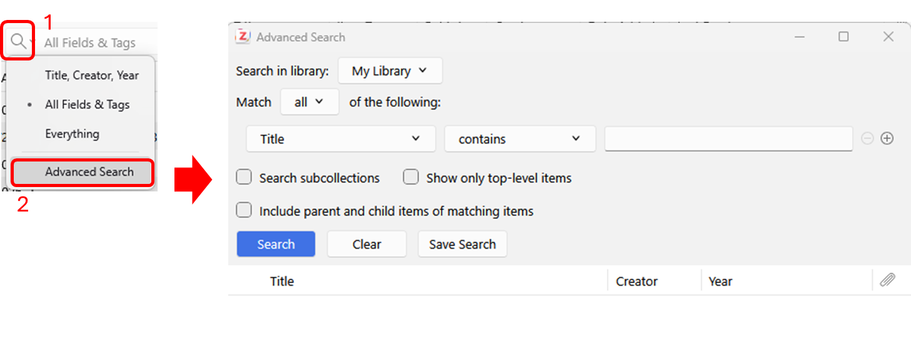

## Wild Cards[\#](https://www.zotero.org/support/searching#wild_cards)

The % percent sign character acts as a wild card in advanced searches,
substituting for zero or more characters. For example, the search term
“W% Shakespeare” will match “W Shakespeare”, “W. Shakespeare” as well as
“William Shakespeare”.

To search for items where a field contains any content at all, search
for the % percent sign character alone.

## Saved Searches[\#](https://www.zotero.org/support/searching#saved_searches)

When you save an Advanced Search, it appears as a collection in your
library but with a Saved Search icon
() instead of the regular
collection icon
(). Saved Searches are
continuously updated. For example, if you set up a Saved Search for
“Date Added” “is in the last” “7” “days”, the saved search will always
show the items that have been added in the last 7 days. Saved searches
only store the search criteria, not the search results. To save a
search, click the “Save Search” button in the Advanced Search window and
provide a name for the search.

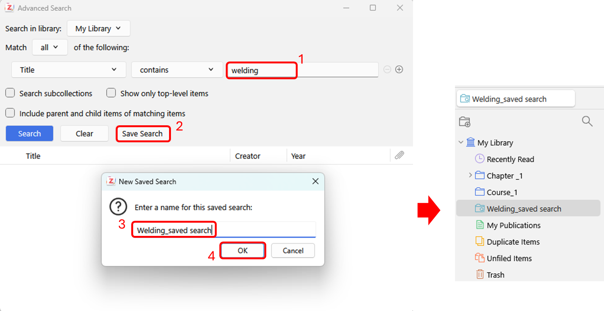

Saved searches can be edited or deleted by right-clicking the Saved
Search and selecting “Edit Saved Search…” or “Delete Saved Search…”,
respectively.

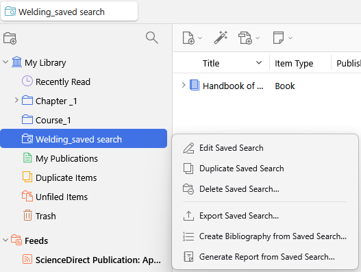

You can also create a saved search in a library by right-clicking on the
library name and choosing “New Saved Search…”.

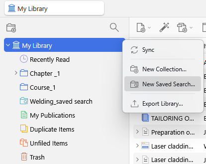

## Complex Search Criteria[\#](https://www.zotero.org/support/searching#complex_search_criteria)

It is possible to run complex Boolean searches by using multiple Saved
Searches. For example, to run the search (a OR b) AND (c OR d), first
make a Saved Search called “Condition1” for (a OR b), then make a Saved
Search called “Condition2” for (c OR d). Finally, run a third Advanced
Search and search for "Collection" "is" "Condition1" AND "Collection"
"is" "Condition2".

# Full-Text Indexing[\#](https://www.zotero.org/support/searching#full-text_indexing)

Full-text indexing allows embedded text within PDFs, EPUBs, HTML, and
text files to be searched with Quick Search (via the “Everything”
option) and Advanced Search (via “Attachment Content”). Indexing happens
automatically in the background when Zotero is idle.

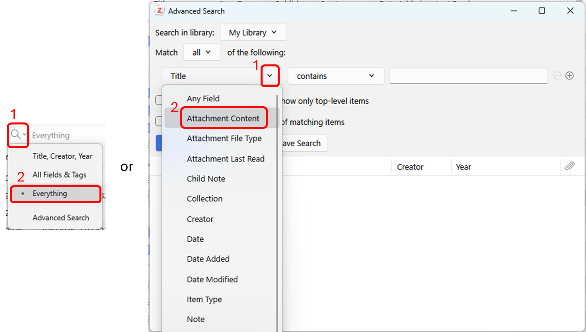

You can control how much text in a PDF/EPUB/HTML/text file is indexed in
the [<u>Search
pane</u>](https://www.zotero.org/support/preferences/search) of
[<u>Zotero preferences</u>](https://www.zotero.org/support/preferences)
(default: 500000 characters, 100 pages). You can remove indexed text
with the “Clear Index…” button or re-create the index from scratch using
the “Rebuild Index…” button. You can check the index status of any
PDF/EPUB/HTML attachment by selecting the attachment item in the Zotero
library and looking at the “Indexed:” field in the right pane.

If an item isn’t being indexed (e.g., if it is not showing up in an
‘Everything’ Quick Search), verify that the item has searchable text and
that the text is properly stored in the PDF (e.g., try to copy text out
of the document and ensure that it is high quality). If the PDF has
valid text, rebuild the item’s index by right-clicking on it and
choosing “Reindex Item”. If you are still having issues, please ask a
question on the [<u>Zotero forums</u>](https://www.zotero.org/forum).

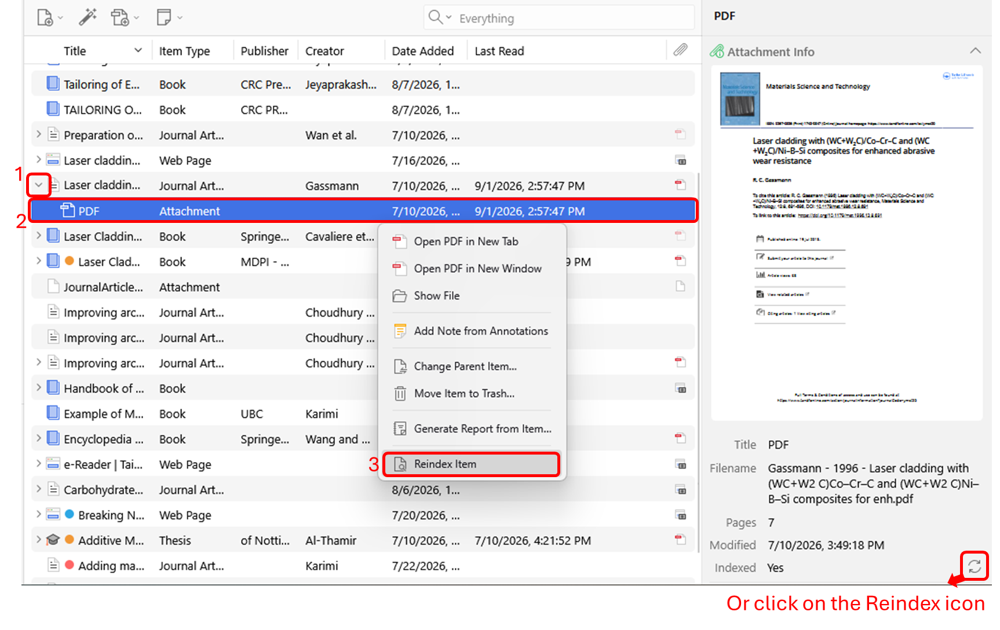Note: At this time, only
PDF/EPUB/HTML full text content (and plain text files) can be indexed by
Zotero. Other document types (e.g., .docx, .odt) cannot be indexed by
Zotero.

# Sorting

Items in the center pane can be sorted by various fields, such as their
title, creators, or the date they were added to your library.

To change the way items are sorted, click on any of the column headers
at the top of the center pane. For example, if you click on “Title”, all
your items will be sorted alphabetically by title. Clicking a header
multiple times toggles between ascending and descending sorts. (The
header will show an upward and downward arrow, respectively.)

By default, Zotero will show columns for the Title, Creators, and
Attachments properties in the center pane. You can change which fields
are shown by right-clicking on the column headers and selecting fields
from the drop-down menu.

For each column, you can also choose the Secondary Sort field (the field
that’s used to break ties when sorting).

By default, fields in the center pane are arranged from left to right in
the order in which they are shown in the drop-down menu. You can
rearrange them by dragging and dropping the headers. To reset the order,
select “Restore Column Order” in the drop-down menu.

# Quick Copy[\#](https://www.zotero.org/support/creating_bibliographies#quick_copy)

If you just want to quickly add references to a paper, email, or blog
post, Zotero’s Quick Copy is the easiest way to go. Simply select items
in the center column and drag them into any text field. Zotero will
automatically create a formatted bibliography for you. To copy citations
instead of references, hold down Shift at the start of the drag.

To configure your Quick Copy preferences, open the Zotero
[<u>settings</u>](https://www.zotero.org/support/kb/preferences) and
select
[<u>Export</u>](https://www.zotero.org/support/preferences/export). From
this tab you can do the following:

- Select the export format
- Set up site-specific export settings
- Choose whether you want Zotero to include HTML markup when copying

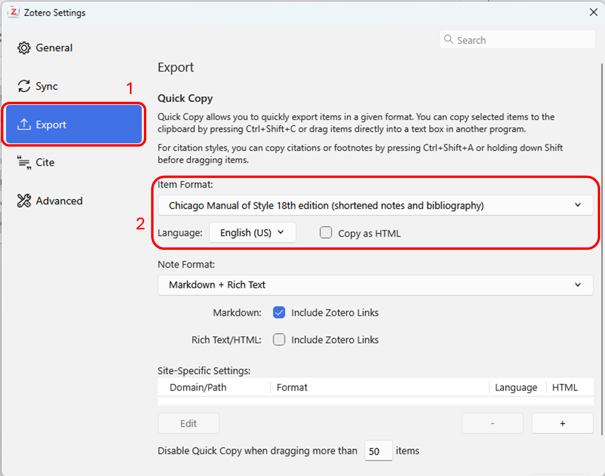

You can also use Edit → Copy Bibliography or press Ctrl/Cmd-Shift-C to
copy bibliography entries to your system clipboard and then paste them
into documents. To copy citations instead of bibliography entries, use
Edit → Copy Citation or Ctrl/Cmd-Shift-A.

In addition to bibliographic output, Quick Copy also supports export
formats such as BibTeX and RIS.

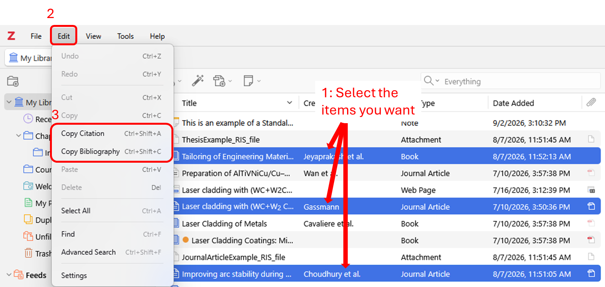

# Right-Click to Create Citation/Bibliography[\#](https://www.zotero.org/support/creating_bibliographies#right-click_to_create_citationbibliography)

To create a bibliography or a citations list in Zotero, highlight one or
more items, right-click them, and select “Create Bibliography from
Item(s)…”. Then select a citation style for your citation/bibliography
format and choose either to create a list of *Citations/Notes* or a
*Bibliography*. Then choose one of the following four ways to create
your citation/bibliography:

- *Save as RTF* will save the bibliography as a rich-text file.

- *Save as HTML* will save the bibliography as an HTML file for viewing
  in a web browser. This format will also embed metadata allowing other
  Zotero users viewing the document to capture bibliographic
  information.

- *Copy to Clipboard* will copy the bibliography to your clipboard for
  pasting into any text field.

- *Print* will send your bibliography straight to a printer.

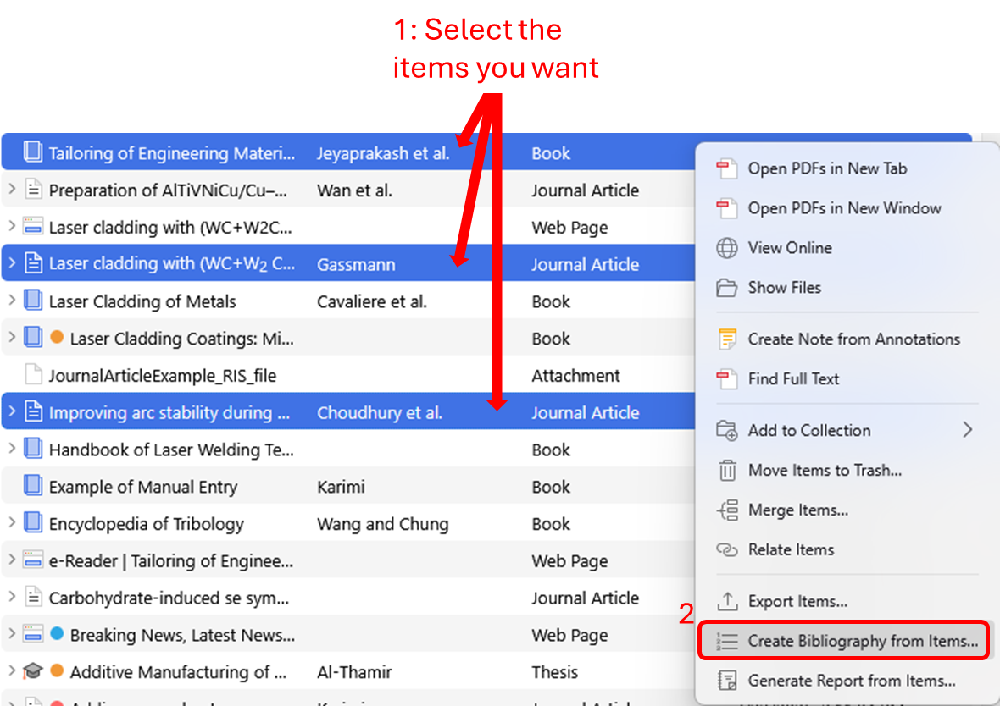
